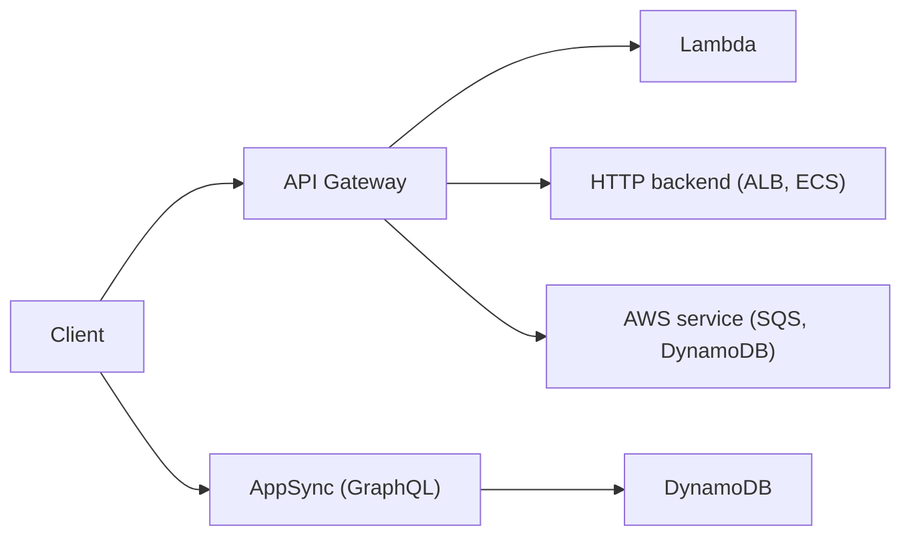

# 7. APIs and market

- [APIs in AWS](#apis-in-aws)
- [Amazon API Gateway](#amazon-api-gateway)
- [AWS AppSync](#aws-appsync)
- [AWS Marketplace](#aws-marketplace)
- [AWS Data Exchange](#aws-data-exchange)

---

## APIs in AWS

- All AWS services have APIs. The console, CLI, SDKs and IaC tools call these APIs.
- AWS signs API requests with Signature Version 4 (SigV4).
- Use Amazon API Gateway or AWS AppSync to publish your own APIs.

## Amazon API Gateway

| Type | Use it for | Main features |
|---|---|---|
| REST API | Full-feature APIs | API keys, usage plans, request validation, caching, WAF, private APIs |
| HTTP API | Simple, low-cost APIs | JWT authorizers, lower latency, lower price |
| WebSocket API | Two-way, real-time messages | Persistent connections, routes by message |

- Endpoint types for REST APIs: edge-optimized, Regional and private.
- Authorization:
  - IAM (SigV4).
  - Amazon Cognito user pools.
  - Lambda authorizers.
  - JWT authorizers (HTTP API).
- Throttling limits requests at account, stage and method levels.
- Usage plans and API keys meter and limit API clients.
- Stages (for example `dev` and `prod`) and stage variables separate environments.
- Canary release sends a percentage of traffic to a new deployment (REST API).
- Integrations: Lambda proxy, HTTP proxy, AWS service and mock.
- Use a VPC link to connect to private resources in a VPC.
- Use AWS WAF to protect REST APIs.
- Send access logs and execution logs to CloudWatch Logs.

## AWS AppSync

- AppSync gives managed GraphQL APIs.
- Data sources: DynamoDB, Lambda, Aurora, OpenSearch, HTTP and EventBridge.
- Subscriptions send real-time data to clients over WebSockets.
- AppSync Events gives serverless WebSocket APIs for publish/subscribe.
- Authorization: API keys, IAM, Cognito, OIDC and Lambda.
- Merged APIs combine many source GraphQL APIs.

## AWS Marketplace

- AWS Marketplace is a digital catalog of third-party software, data and services.
- Product types: AMIs, containers, SaaS, ML models, data products and professional services.
- AWS bills Marketplace purchases on your AWS bill.
- Pricing models: free, hourly, annual, contract and bring your own license (BYOL).
- Private offers give custom prices for a buyer.
- Private Marketplace lets administrators control the list of approved products.
- Use AWS License Manager to track software licenses.

## AWS Data Exchange

- Data Exchange lets you find, subscribe to and use third-party data.
- Delivery methods: S3 files, Amazon Redshift data shares, APIs and AWS Lake Formation.
- Providers publish data products through AWS Marketplace.
