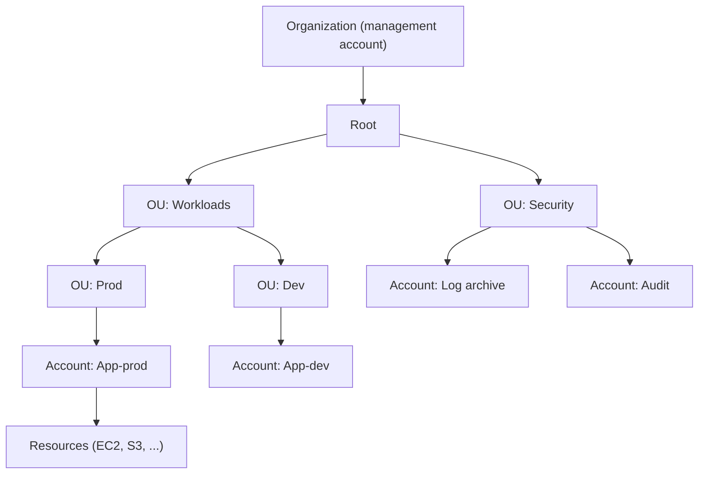

# 1. Access and resource management

- [Interacting with AWS](#interacting-with-aws)
- [Resource hierarchy](#resource-hierarchy)
- [AWS Organizations](#aws-organizations)
- [AWS Control Tower](#aws-control-tower)
- [AWS IAM](#aws-iam)
- [IAM Identity Center](#iam-identity-center)
- [Regions and Availability Zones](#regions-and-availability-zones)
- [Tags and resource groups](#tags-and-resource-groups)
- [Billing and cost management](#billing-and-cost-management)
- [Amazon Q Developer](#amazon-q-developer)
- [Recommendations](#recommendations)

---

## Interacting with AWS

| Tool | Use |
|---|---|
| AWS Management Console | Use a web browser to manage resources. |
| AWS CLI | Run commands from a terminal or a script. |
| AWS CloudShell | Use a browser shell. It has the AWS CLI and your credentials. |
| AWS SDKs | Call AWS APIs from code (Python boto3, Java, JavaScript, Go, and more). |
| AWS CloudFormation and AWS CDK | Define resources as code. Refer to section 8. |

- All tools call the same AWS APIs.
- Each API call needs credentials. AWS signs each request with Signature Version 4.

## Resource hierarchy

- The **account** is the main boundary for security, billing, and quotas.
- An **organizational unit (OU)** groups accounts. OUs can contain other OUs.
- Policies that you attach to an OU apply to all accounts below it.
- Use separate accounts for each environment and each workload.

## AWS Organizations

- Organizations manages many accounts from one **management account**.
- Features:
  - **Consolidated billing**: one bill. Volume discounts and Savings Plans apply across accounts.
  - **Service control policies (SCPs)**: set the maximum permissions for accounts. SCPs do not give permissions.
  - **Resource control policies (RCPs)**: set the maximum permissions on resources, such as S3 buckets and KMS keys.
  - **Declarative policies**: enforce a service configuration, such as "block public AMI sharing".
  - **Tag policies, backup policies, and AI services opt-out policies**.
  - **Delegated administrator**: let a member account manage a service, such as GuardDuty.
- SCPs do not apply to the management account. Do not run workloads in the management account.

## AWS Control Tower

- Control Tower sets up a **landing zone**: a multi-account environment with good practices.
- It creates a Log Archive account and an Audit account.
- **Controls** (guardrails):
  - Preventive: SCPs and RCPs.
  - Detective: AWS Config rules.
  - Proactive: CloudFormation hooks that check resources before deployment.
- **Account Factory** creates new accounts from a template. Account Factory for Terraform (AFT) uses Terraform.
- Use Control Tower for a new multi-account setup. Use Organizations alone for full manual control.

## AWS IAM

- IAM controls who can do which actions on which resources.
- Identities:
  - **Root user**: full access. Turn on MFA. Do not use it for daily tasks.
  - **IAM user**: long-term credentials. Avoid users for people. Use IAM Identity Center.
  - **IAM role**: temporary credentials. Services, applications, and federated users assume roles.
  - **IAM group**: a set of IAM users.
- Policy types:

| Policy | Attaches to | Effect |
|---|---|---|
| Identity-based | User, group, role | Gives permissions |
| Resource-based | Resource (S3 bucket, KMS key, SQS queue) | Gives permissions, also cross-account |
| Permissions boundary | User or role | Sets maximum permissions |
| SCP / RCP | Account or OU | Sets maximum permissions |
| Session policy | Assumed role session | Limits the session |

- Evaluation logic:
  1. An explicit `Deny` always wins.
  2. An `Allow` is necessary in each applicable policy type.
  3. If no `Allow` exists, the default is deny.
- Use **IAM Access Analyzer** to find public or cross-account access and unused permissions. It also generates policies from CloudTrail activity.
- Use **AWS STS** to get temporary credentials (`AssumeRole`, `AssumeRoleWithWebIdentity`, `AssumeRoleWithSAML`).

## IAM Identity Center

- IAM Identity Center gives workforce users single sign-on to many accounts and applications.
- Identity sources: the Identity Center directory, AWS Managed Microsoft AD, or an external IdP (Okta, Microsoft Entra ID) with SAML 2.0 and SCIM.
- A **permission set** defines access. Identity Center creates a role from it in each target account.
- Use Identity Center for people. Use IAM roles for workloads.

## Regions and Availability Zones

- A **Region** is a geographic area. Each Region has at least three Availability Zones.
- An **Availability Zone (AZ)** is one or more data centers with separate power and networking.
- **Local Zones** put compute near large cities for low latency.
- **Wavelength Zones** put compute in 5G telecom networks.
- **AWS Outposts** runs AWS infrastructure in your data center.
- Some services are global: IAM, Route 53, CloudFront, Organizations.
- Choose a Region for latency, data residency, service availability, and price.

## Tags and resource groups

- A tag is a key-value pair on a resource.
- Use tags for cost allocation, automation, and attribute-based access control (ABAC).
- Activate **cost allocation tags** in the Billing console to see them in cost reports.
- **Resource Groups** and **Tag Editor** find and manage resources by tag.

## Billing and cost management

| Service | Use |
|---|---|
| AWS Budgets | Set cost or usage limits. Send alerts or run actions. |
| Cost Explorer | Analyze and forecast costs. |
| Cost and Usage Reports (CUR 2.0, Data Exports) | Export detailed billing data to S3. Query it with Athena. |
| Cost Anomaly Detection | Find unusual spend with ML. |
| Pricing Calculator | Estimate cost before deployment. |
| Billing Conductor | Create custom billing views for groups of accounts. |

- Purchase options: On-Demand, Savings Plans, Reserved Instances, and Spot Instances. Refer to section 12.2.

## Amazon Q Developer

- Q Developer is a generative AI assistant for builders.
- It writes and explains code in IDEs and in the command line.
- In the console, it answers questions about your resources and costs.
- It can help to upgrade code, for example Java versions.

## Recommendations

| Service | Recommends |
|---|---|
| AWS Trusted Advisor | Cost, security, fault tolerance, performance, and service limits checks |
| AWS Compute Optimizer | Right size for EC2, Auto Scaling groups, EBS, Lambda, ECS on Fargate, RDS |
| Cost Optimization Hub | One view of cost savings across accounts |
| Service Quotas | View quotas and request increases |
