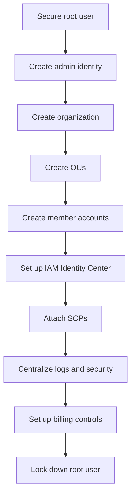
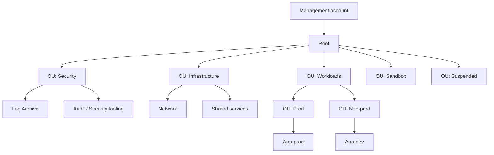

# 1.2 Set up an organization from the root account

- [Overview](#overview)
- [Step 1: Secure the root user](#step-1-secure-the-root-user)
- [Step 2: Create an admin identity](#step-2-create-an-admin-identity)
- [Step 3: Create the organization](#step-3-create-the-organization)
- [Step 4: Create the OU structure](#step-4-create-the-ou-structure)
- [Step 5: Create the member accounts](#step-5-create-the-member-accounts)
- [Step 6: Set up IAM Identity Center](#step-6-set-up-iam-identity-center)
- [Step 7: Turn on policies and attach SCPs](#step-7-turn-on-policies-and-attach-scps)
- [Step 8: Centralize logging and security](#step-8-centralize-logging-and-security)
- [Step 9: Set up billing controls](#step-9-set-up-billing-controls)
- [Step 10: Lock down the root user](#step-10-lock-down-the-root-user)
- [Sign in as the root user with the CLI](#sign-in-as-the-root-user-with-the-cli)
- [Alternative: AWS Control Tower](#alternative-aws-control-tower)
- [Checklist](#checklist)

Refer to [Access and resource management](<Access and resource management.md>) for the concepts. Refer to [AWS CLI commands](<AWS CLI commands.md>) for more commands.

---

## Overview

- The first account that you create becomes the **management account**.
- Use the management account only for Organizations, billing, and Identity Center.
- Do not run workloads in the management account. SCPs do not apply to it.
- Use the root user only for the first steps. Then use IAM Identity Center.



Target structure:



## Step 1: Secure the root user

Do these steps in the console. Sign in with the root user email and password.

1. Use a group email address for the root user, such as `aws-root@example.com`. Do not use a personal email.
2. Set a strong, unique password. Keep it in a password manager.
3. Turn on MFA. Go to **Account name > Security credentials > Assign MFA device**.
   - Use a hardware key (FIDO2) or a passkey. You can register a maximum of 8 MFA devices.
4. Delete all root access keys. On the same page, make sure that **Access keys** is empty.
5. Go to **Account > Alternate contacts**. Add contacts for billing, operations, and security.
6. Go to **Account > IAM user and role access to Billing information**. Select **Activate IAM Access**.

## Step 2: Create an admin identity

- You need an identity that is not root for the next steps.
- Identity Center needs an organization. So, create a temporary IAM user first, or continue with root to Step 6.

1. Go to **IAM > Users > Create user**. Name it `bootstrap-admin`.
2. Attach the `AdministratorAccess` policy.
3. Turn on MFA for the user.
4. Sign out of root. Sign in as `bootstrap-admin`.

> Delete `bootstrap-admin` after Step 6.

## Step 3: Create the organization

Console: **AWS Organizations > Create an organization**.

CLI:

```bash
aws organizations create-organization --feature-set ALL
aws organizations describe-organization
```

- `ALL` turns on all features, including SCPs. Do not use `CONSOLIDATED_BILLING`.
- AWS sends a verification email to the management account address. Confirm it.

## Step 4: Create the OU structure

```bash
ROOT_ID=$(aws organizations list-roots --query 'Roots[0].Id' --output text)

for OU in Security Infrastructure Workloads Sandbox Suspended; do
  aws organizations create-organizational-unit --parent-id "$ROOT_ID" --name "$OU"
done

WL_ID=$(aws organizations list-organizational-units-for-parent --parent-id "$ROOT_ID" \
  --query "OrganizationalUnits[?Name=='Workloads'].Id" --output text)

aws organizations create-organizational-unit --parent-id "$WL_ID" --name Prod
aws organizations create-organizational-unit --parent-id "$WL_ID" --name Non-prod
```

| OU | Use |
|---|---|
| Security | Log Archive and Audit accounts. |
| Infrastructure | Shared network and shared services. |
| Workloads / Prod, Non-prod | Application accounts. |
| Sandbox | Experiments. Use strict budgets. |
| Suspended | Accounts that you will close. Deny all actions. |

## Step 5: Create the member accounts

- Each account needs a unique email address. Use plus addressing, such as `aws+log-archive@example.com`.

```bash
aws organizations create-account \
  --email aws+log-archive@example.com \
  --account-name "Log Archive" \
  --role-name OrganizationAccountAccessRole \
  --iam-user-access-to-billing ALLOW

# Check the status until it is SUCCEEDED
aws organizations describe-create-account-status \
  --create-account-request-id <request-id>

# Move the account to its OU
aws organizations move-account --account-id <account-id> \
  --source-parent-id "$ROOT_ID" --destination-parent-id <security-ou-id>
```

- Repeat for Audit, Network, Shared services, App-prod, and App-dev.
- Organizations creates `OrganizationAccountAccessRole` in each account. The management account can assume it.
- New accounts have a root user without a password. Turn on **centralized root access** to manage it (Step 10).

## Step 6: Set up IAM Identity Center

1. Go to **IAM Identity Center > Enable** in your home Region.
2. Choose the identity source:
   - Identity Center directory (simple start).
   - External IdP (Okta, Microsoft Entra ID) with SAML 2.0 and SCIM.
3. Create groups, such as `Admins`, `Developers`, `ReadOnly`, `Billing`.
4. Create permission sets:

| Permission set | Policy | Session |
|---|---|---|
| AdministratorAccess | `AdministratorAccess` | 1 hour |
| PowerUser | `PowerUserAccess` | 4 hours |
| ReadOnly | `ReadOnlyAccess` | 8 hours |
| Billing | `job-function/Billing` | 4 hours |

5. Assign groups to accounts with permission sets.

```bash
INSTANCE_ARN=$(aws sso-admin list-instances --query 'Instances[0].InstanceArn' --output text)

aws sso-admin create-permission-set --instance-arn "$INSTANCE_ARN" \
  --name AdministratorAccess --session-duration PT1H

aws sso-admin attach-managed-policy-to-permission-set --instance-arn "$INSTANCE_ARN" \
  --permission-set-arn <ps-arn> --managed-policy-arn arn:aws:iam::aws:policy/AdministratorAccess

aws sso-admin create-account-assignment --instance-arn "$INSTANCE_ARN" \
  --target-id <account-id> --target-type AWS_ACCOUNT \
  --permission-set-arn <ps-arn> --principal-type GROUP --principal-id <group-id>
```

6. Turn on MFA for Identity Center users: **Settings > Authentication > Configure MFA > Every time they sign in**.
7. Sign in through the AWS access portal. Test the access.
8. Delete the `bootstrap-admin` IAM user.
9. Optional: register the Audit account as a delegated administrator for Identity Center.

## Step 7: Turn on policies and attach SCPs

```bash
aws organizations enable-policy-type --root-id "$ROOT_ID" --policy-type SERVICE_CONTROL_POLICY
aws organizations enable-policy-type --root-id "$ROOT_ID" --policy-type TAG_POLICY
aws organizations enable-policy-type --root-id "$ROOT_ID" --policy-type BACKUP_POLICY
```

Recommended SCPs:

| SCP | Attach to |
|---|---|
| Deny `organizations:LeaveOrganization` | Root |
| Deny changes to CloudTrail, Config, GuardDuty | Root |
| Deny Regions that you do not use | Root |
| Deny actions by the root user of member accounts | Root |
| Deny all actions | Suspended OU |

Example: deny unused Regions and root user actions (`baseline-scp.json`):

```json
{
  "Version": "2012-10-17",
  "Statement": [
    {
      "Sid": "DenyLeaveOrg",
      "Effect": "Deny",
      "Action": "organizations:LeaveOrganization",
      "Resource": "*"
    },
    {
      "Sid": "DenyRootUser",
      "Effect": "Deny",
      "Action": "*",
      "Resource": "*",
      "Condition": { "StringLike": { "aws:PrincipalArn": "arn:aws:iam::*:root" } }
    },
    {
      "Sid": "DenyUnusedRegions",
      "Effect": "Deny",
      "NotAction": [
        "iam:*", "organizations:*", "sts:*", "support:*", "budgets:*",
        "ce:*", "cloudfront:*", "route53:*", "sso:*", "health:*"
      ],
      "Resource": "*",
      "Condition": {
        "StringNotEquals": { "aws:RequestedRegion": ["eu-west-1", "us-east-1"] }
      }
    }
  ]
}
```

```bash
aws organizations create-policy --name Baseline --type SERVICE_CONTROL_POLICY \
  --description "Baseline guardrails" --content file://baseline-scp.json
aws organizations attach-policy --policy-id <policy-id> --target-id "$ROOT_ID"
```

- Test SCPs on the Sandbox OU first. A wrong SCP can block all access.
- Keep the default `FullAWSAccess` SCP attached. SCPs only limit. They do not give permissions.

## Step 8: Centralize logging and security

1. **CloudTrail organization trail**: create it in the management account. Send logs to an S3 bucket in Log Archive.

```bash
aws organizations enable-aws-service-access --service-principal cloudtrail.amazonaws.com
aws cloudtrail create-trail --name org-trail --s3-bucket-name <log-archive-bucket> \
  --is-organization-trail --is-multi-region-trail --enable-log-file-validation
aws cloudtrail start-logging --name org-trail
```

2. **Delegate security services** to the Audit account:

```bash
AUDIT=<audit-account-id>
aws guardduty enable-organization-admin-account --admin-account-id "$AUDIT"
aws securityhub enable-organization-admin-account --admin-account-id "$AUDIT"
aws organizations register-delegated-administrator --account-id "$AUDIT" \
  --service-principal config.amazonaws.com
aws accessanalyzer create-analyzer --analyzer-name org --type ORGANIZATION
```

3. In the Audit account, turn on auto-enable for new member accounts in GuardDuty and Security Hub.
4. Turn on **AWS Config** in all accounts and Regions. Use an aggregator in the Audit account.
5. Turn on **IAM Access Analyzer** with organization scope in the Audit account.

## Step 9: Set up billing controls

1. Create a budget in the management account with email alerts.

```bash
aws budgets create-budget --account-id <mgmt-account-id> \
  --budget file://budget.json --notifications-with-subscribers file://notifications.json
```

2. Turn on **Cost Anomaly Detection** with a monitor for each linked account.
3. Activate **cost allocation tags**, such as `CostCenter`, `Environment`, `Owner`.
4. Attach a **tag policy** to enforce tag keys and values.
5. Create a **Data Export (CUR 2.0)** to an S3 bucket for detailed analysis.

## Step 10: Lock down the root user

1. Turn on **centralized root access** for member accounts:

```bash
aws organizations enable-aws-service-access --service-principal iam.amazonaws.com
aws iam enable-organizations-root-credentials-management
aws iam enable-organizations-root-sessions
```

- This removes root credentials from member accounts. The management account can do privileged root tasks when it is necessary.

2. For the management account root user:
   - Keep MFA on. Keep backup MFA devices in a safe place.
   - Make sure that no root access keys exist.
   - Create a CloudWatch alarm or EventBridge rule for root user sign-in.
3. Use the root user only for tasks that need it. Examples: change the account email, close the account, restore IAM access.

## Sign in as the root user with the CLI

- The root user cannot use `aws configure sso` or `aws login` with a password and MFA.
- The CLI needs credentials. For root, there are two methods.

| Method | Account | Recommended |
|---|---|---|
| `sts assume-root` from the management account | Member accounts | Yes |
| Root access keys | Any account | No. Use only for an emergency. Delete the keys after use. |

### Method 1: Root session for a member account (`assume-root`)

Prerequisites:
- Centralized root access is on (Step 10).
- You are signed in to the management account (or the delegated administrator account) with a role that has `sts:AssumeRoot`.

1. Sign in to the management account with IAM Identity Center:

```bash
aws sso login --profile mgmt-admin
```

2. Get a root session for the member account. Select a task policy for the task.

```bash
aws sts assume-root --profile mgmt-admin \
  --target-principal <member-account-id> \
  --task-policy-arn arn=arn:aws:iam::aws:policy/root-task/IAMAuditRootUserCredentials \
  --duration-seconds 900
```

| Task policy | Use |
|---|---|
| `IAMAuditRootUserCredentials` | Audit the root credentials. |
| `IAMCreateRootUserPassword` | Allow password recovery for root. |
| `IAMDeleteRootUserCredentials` | Delete root password, access keys, MFA, and certificates. |
| `S3UnlockBucketPolicy` | Delete a bucket policy that denies all principals. |
| `SQSUnlockQueuePolicy` | Delete a queue policy that denies all principals. |

3. Export the temporary credentials. The session expires after a maximum of 15 minutes.

```bash
CREDS=$(aws sts assume-root --profile mgmt-admin \
  --target-principal <member-account-id> \
  --task-policy-arn arn=arn:aws:iam::aws:policy/root-task/S3UnlockBucketPolicy \
  --query Credentials --output json)

export AWS_ACCESS_KEY_ID=$(echo "$CREDS" | jq -r .AccessKeyId)
export AWS_SECRET_ACCESS_KEY=$(echo "$CREDS" | jq -r .SecretAccessKey)
export AWS_SESSION_TOKEN=$(echo "$CREDS" | jq -r .SessionToken)
```

4. Make sure that you are root in the member account:

```bash
aws sts get-caller-identity
# "Arn": "arn:aws:iam::<member-account-id>:root"
```

5. Do the task. Example:

```bash
aws s3api delete-bucket-policy --bucket <locked-bucket>
```

6. Remove the credentials from the shell:

```bash
unset AWS_ACCESS_KEY_ID AWS_SECRET_ACCESS_KEY AWS_SESSION_TOKEN
```

### Method 2: Root access keys (emergency only)

- Use this method only if no other method is possible. An example is the management account root user.
- Root access keys have full access and do not expire. AWS recommends that you do not create them.

1. Sign in to the console as root (MFA is necessary).
2. Go to **Account name > Security credentials > Access keys > Create access key**.
3. Configure a separate profile:

```bash
aws configure --profile root-emergency
aws sts get-caller-identity --profile root-emergency
```

4. Optional: use MFA with the CLI. Root can call `get-session-token` with its MFA device:

```bash
aws sts get-session-token --profile root-emergency \
  --serial-number arn:aws:iam::<account-id>:mfa/<device-name> \
  --token-code 123456 --duration-seconds 900
```

- Root sessions from `get-session-token` last a maximum of 1 hour.

5. Do the task.
6. Delete the access key in the console. Then remove the profile:

```bash
aws iam list-access-keys --profile root-emergency
aws iam delete-access-key --profile root-emergency --access-key-id <key-id>
# Then delete the [root-emergency] entries in ~/.aws/credentials and ~/.aws/config
```

> CloudTrail logs all root activity. Make sure that a root sign-in alert exists (Step 10).

## Alternative: AWS Control Tower

- Control Tower does Steps 3, 4, 5, 7, and 8 for you.
- After Step 1 and Step 2, go to **Control Tower > Set up landing zone**.
- It creates the Security OU, Log Archive account, and Audit account. It turns on Identity Center, CloudTrail, and Config.
- Use **Account Factory** to create new accounts.
- Then do Step 9 and Step 10.

| Approach | Use when |
|---|---|
| Control Tower | New setup. You want good defaults fast. |
| Organizations alone | You need full control, or you use your own automation (Terraform, CDK). |

## Checklist

- [ ] Root user has MFA, a strong password, and no access keys.
- [ ] Alternate contacts are set.
- [ ] Organization uses all features.
- [ ] OUs: Security, Infrastructure, Workloads, Sandbox, Suspended.
- [ ] Log Archive and Audit accounts exist.
- [ ] IAM Identity Center is on, with MFA and permission sets.
- [ ] No IAM users for people. `bootstrap-admin` is deleted.
- [ ] Baseline SCPs are attached and tested.
- [ ] Organization CloudTrail sends logs to Log Archive.
- [ ] GuardDuty, Security Hub, Config, and Access Analyzer are delegated to Audit.
- [ ] Budgets, anomaly detection, and cost allocation tags are on.
- [ ] Centralized root access is on for member accounts.
- [ ] No workloads run in the management account.
- [ ] No root access keys exist after an emergency task.
