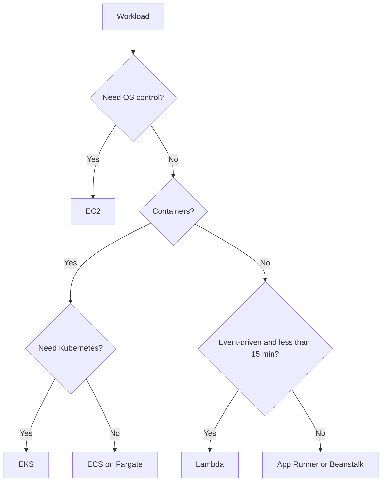
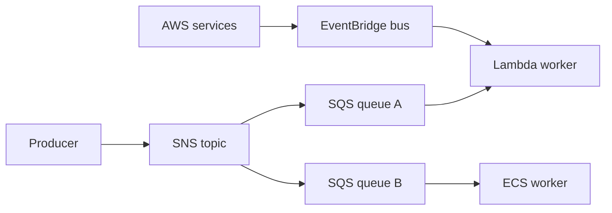

# 5. Computation

- [Computation Services](#computation-services)
- [Amazon EC2](#amazon-ec2)
- [EC2 Auto Scaling](#ec2-auto-scaling)
- [Amazon ECS](#amazon-ecs)
- [Amazon EKS](#amazon-eks)
- [AWS Fargate](#aws-fargate)
- [AWS Lambda](#aws-lambda)
- [AWS App Runner](#aws-app-runner)
- [AWS Elastic Beanstalk](#aws-elastic-beanstalk)
- [AWS Batch](#aws-batch)
- [Messaging: SNS, SQS and EventBridge](#messaging-sns-sqs-and-eventbridge)
- [Amazon MSK](#amazon-msk)
- [Amazon Lightsail](#amazon-lightsail)
- [AWS Outposts](#aws-outposts)

---

## Computation Services

AWS gives compute services at different levels of control. More control gives more operation work.

| Service | Model | You manage | Use it for |
|---|---|---|---|
| EC2 | IaaS (virtual machines) | OS, runtime, scaling | Full control, special hardware |
| ECS | Container orchestration | Tasks, services | AWS-native containers |
| EKS | Managed Kubernetes | Workloads, add-ons | Kubernetes portability |
| Fargate | Serverless containers | Task definitions | Containers without servers |
| Lambda | Functions (FaaS) | Code only | Events, short jobs (max 15 min) |
| App Runner | Managed web apps | Code or image | Simple web services and APIs |
| Elastic Beanstalk | PaaS | Application code | Classic web apps |
| Batch | Batch jobs | Job definitions | Large batch and HPC jobs |

## Amazon EC2

- EC2 gives resizable virtual machines (instances).
- An Amazon Machine Image (AMI) defines the OS and software of an instance.
- Instance families:
  - General purpose: M, T (burstable).
  - Compute optimized: C.
  - Memory optimized: R, X.
  - Accelerated: P, G (GPU), Trn (AWS Trainium), Inf (AWS Inferentia).
  - Storage optimized: I, D.
- Graviton instances use AWS Arm processors. They give better price performance.
- Purchase options:
  - On-Demand: pay by the second. No commitment.
  - Savings Plans and Reserved Instances: 1-year or 3-year commitment for lower price.
  - Spot: unused capacity with up to 90% discount. AWS can stop the instance with a 2-minute notice.
  - Dedicated Hosts: physical server for licensing needs.
  - Capacity Reservations and Capacity Blocks for ML: reserve capacity in an Availability Zone.
- Placement groups:
  - Cluster: low latency in one AZ.
  - Spread: different hardware for each instance.
  - Partition: groups of racks for big distributed systems.
- Use launch templates to keep the instance configuration.
- Use user data to run scripts at the first boot.
- Use instance profiles (IAM roles) for credentials. Do not keep access keys on instances.

## EC2 Auto Scaling

- An Auto Scaling group (ASG) keeps a minimum, maximum and desired number of instances.
- Scaling policies:
  - Target tracking: keep a metric at a target, for example 50% CPU.
  - Step scaling: add or remove capacity by alarm thresholds.
  - Scheduled scaling: change capacity at set times.
  - Predictive scaling: use history to scale before the load comes.
- Health checks replace unhealthy instances. Use ELB health checks for applications.
- Mixed instances policies use On-Demand and Spot in one group.
- Instance refresh replaces instances to apply a new launch template.
- Warm pools keep stopped instances ready to decrease start time.

## Amazon ECS

- ECS is the AWS-native container orchestrator.
- A task definition describes containers, CPU, memory, IAM role and network.
- A service keeps the desired number of tasks and connects them to a load balancer.
- Launch types: Fargate, EC2 and ECS Anywhere (on-premises servers).
- ECS Service Connect gives service discovery and traffic metrics between services.
- Deployment types: rolling update and blue/green (native in ECS or with CodeDeploy).
- Capacity providers manage the mix of Fargate, Fargate Spot and EC2 capacity.

## Amazon EKS

- EKS gives a managed Kubernetes control plane in multiple AZs.
- Node options:
  - Managed node groups: AWS manages EC2 node life cycle.
  - Self-managed nodes: you manage EC2 nodes.
  - Fargate: one pod for each micro VM.
  - Karpenter: open-source autoscaler. It selects the best instance types quickly.
  - EKS Auto Mode: AWS manages nodes, scaling, networking and storage add-ons.
- EKS Pod Identity and IRSA give IAM roles to pods.
- EKS Anywhere and EKS Hybrid Nodes run workloads on-premises.
- Use EKS add-ons for VPC CNI, CoreDNS, kube-proxy and EBS CSI driver.

## AWS Fargate

- Fargate is a serverless compute engine for ECS and EKS.
- You do not manage servers or patch the OS.
- You pay for vCPU and memory for the run time of the task.
- Fargate Spot gives a discount for interruption-tolerant tasks.
- Each task has its own isolation boundary.

## AWS Lambda

- Lambda runs code as a response to events. You pay for requests and duration.
- Limits: 15 minutes maximum duration, up to 10 GB memory.
- Triggers: API Gateway, S3, SQS, SNS, EventBridge, DynamoDB Streams, Kinesis and more.
- Packages: ZIP file or container image (up to 10 GB).
- Concurrency controls:
  - Reserved concurrency: limit or protect the capacity of a function.
  - Provisioned concurrency: keep instances ready. It decreases cold starts.
  - SnapStart: decrease start time for Java, Python and .NET.
- Use Layers to share libraries between functions.
- Use versions and aliases for safe deployments and traffic shift.
- Use destinations or dead-letter queues for failed asynchronous events.
- Function URLs give an HTTPS endpoint without API Gateway.

## AWS App Runner

- App Runner builds and runs web applications from source code or a container image.
- It gives load balancing, TLS, auto scaling and health checks.
- Use it for simple web services when you do not want to manage ECS or EKS.
- Use a VPC connector to access private resources.

## AWS Elastic Beanstalk

- Elastic Beanstalk is a PaaS for web applications.
- You upload code. Beanstalk creates EC2, ASG, load balancer and monitoring.
- Platforms: Java, .NET, Node.js, Python, PHP, Ruby, Go and Docker.
- Deployment policies: all at once, rolling, rolling with additional batch, immutable, traffic splitting.
- Use blue/green with a CNAME swap between two environments.

## AWS Batch

- Batch runs batch jobs at any scale.
- Compute environments use EC2, Spot, Fargate or EKS.
- Job queues send jobs to compute environments by priority.
- Array jobs run many copies of one job with different inputs.
- Multi-node parallel jobs support HPC and distributed ML training.

## Messaging: SNS, SQS and EventBridge

| Service | Pattern | Main features |
|---|---|---|
| SNS | Publish/subscribe (push) | Fan-out to SQS, Lambda, HTTP, email, SMS. FIFO topics. |
| SQS | Queue (pull) | Standard (at-least-once) or FIFO (exactly-once, order). Dead-letter queues. |
| EventBridge | Event bus | Rules filter events. Targets in AWS and SaaS. Archive and replay. |

- Use SQS to decouple components and absorb load spikes.
- Set the visibility timeout longer than the processing time.
- Use long polling to decrease empty responses and cost.
- Use SNS plus SQS for fan-out.
- Use EventBridge for routing based on event content.

## Amazon MSK

- MSK is managed Apache Kafka.
- Options: MSK Provisioned (you select brokers) and MSK Serverless.
- MSK Connect runs Kafka Connect connectors.
- Use MSK when you need Kafka APIs, ordering in partitions and long retention.
- Use Kinesis Data Streams for a simpler AWS-native streaming service.

## Amazon Lightsail

- Lightsail gives simple virtual servers, containers, databases and load balancers.
- It has a fixed monthly price.
- Use it for small websites, test environments and simple applications.

## AWS Outposts

- Outposts puts AWS infrastructure in your data center.
- It runs EC2, EBS, ECS, EKS, RDS and S3 on-premises.
- Use it for low latency, local data processing or data residency.
- Related options: Local Zones (AWS-managed, near cities) and Wavelength (5G edge).
