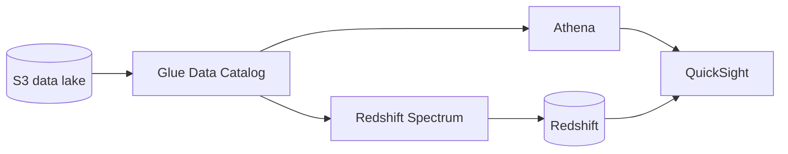

# 11.3. Analytics and Visualization

- [Analytics services on AWS](#analytics-services-on-aws)
- [Amazon Athena](#amazon-athena)
- [Amazon Redshift](#amazon-redshift)
- [Amazon QuickSight and Amazon Quick Suite](#amazon-quicksight-and-amazon-quick-suite)
- [Amazon OpenSearch Service](#amazon-opensearch-service)

---

## Analytics services on AWS

| Need | AWS service |
|---|---|
| Ad hoc SQL on S3 | Amazon Athena |
| Data warehouse | Amazon Redshift |
| Dashboards and BI | Amazon QuickSight (part of Amazon Quick Suite) |
| Log analytics and search | Amazon OpenSearch Service |
| One studio for data and AI | Amazon SageMaker Unified Studio |

## Amazon Athena

- Athena is serverless SQL on data in S3.
- It uses the Glue Data Catalog for table definitions.
- You pay for each TB scanned, or for provisioned capacity.
- Reduce cost:
  - Use columnar formats (Parquet, ORC).
  - Compress the data.
  - Partition the data. Use partition projection for many partitions.
- **Federated query** reads RDS, DynamoDB, and other sources with Lambda connectors.
- **Athena for Apache Spark** runs notebooks with Spark.
- Athena supports Apache Iceberg tables with `UPDATE`, `MERGE`, and time travel.
- Use **workgroups** to separate users and set data scan limits.

## Amazon Redshift

- Redshift is a columnar, massively parallel data warehouse.
- Deployment:
  - **Provisioned:** RA3 nodes with managed storage.
  - **Serverless:** capacity in RPUs. It scales automatically.
- **Redshift Spectrum** queries data in S3 without loading it.
- Load data with `COPY` from S3. Use auto-copy for new S3 files.
- Distribution styles: `AUTO`, `EVEN`, `KEY`, `ALL`.
- Sort keys reduce the data that Redshift scans.
- **Materialized views** store precomputed results.
- **Concurrency scaling** adds capacity for query peaks.
- **Redshift ML** trains models with SQL. It uses SageMaker Autopilot.
- **Streaming ingestion** reads from Kinesis and MSK.

## Amazon QuickSight and Amazon Quick Suite

- QuickSight is a serverless BI service.
- In 2025 AWS put QuickSight in **Amazon Quick Suite**. Quick Suite adds AI agents, research, and automation.
- **SPICE** is the in-memory engine for fast dashboards.
- Data sources: Athena, Redshift, RDS, S3, and SaaS sources.
- Natural language Q&A and generated narratives use Amazon Q features.
- **Row-level security** and **column-level security** limit data for each user.
- Embed dashboards in applications.

## Amazon OpenSearch Service

- OpenSearch Service runs OpenSearch and legacy Elasticsearch clusters.
- **OpenSearch Serverless** removes cluster management.
- Use cases: log analytics, full-text search, vector search.
- **OpenSearch Dashboards** visualize the data.
- **Storage tiers:** hot, UltraWarm, and cold.
- **OpenSearch Ingestion** is a managed pipeline from sources to OpenSearch.
