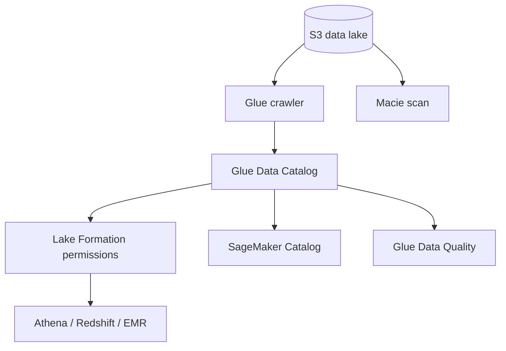

# 11.5. Data Governance

- [Data governance services on AWS](#data-governance-services-on-aws)
- [AWS Lake Formation](#aws-lake-formation)
- [AWS Glue Data Catalog](#aws-glue-data-catalog)
- [SageMaker Catalog and Amazon DataZone](#sagemaker-catalog-and-amazon-datazone)
- [Amazon Macie](#amazon-macie)
- [AWS Glue Data Quality](#aws-glue-data-quality)
- [Audit and compliance](#audit-and-compliance)

---

## Data governance services on AWS

| Governance task | AWS service |
|---|---|
| Fine-grained access to the data lake | AWS Lake Formation |
| Technical metadata | AWS Glue Data Catalog |
| Business catalog, discovery, and subscription | SageMaker Catalog (Amazon DataZone) |
| Find sensitive data | Amazon Macie |
| Data quality rules | AWS Glue Data Quality |
| Audit | AWS CloudTrail, AWS Config |

## AWS Lake Formation

- Lake Formation gives central permissions for the Data Catalog and S3 data.
- Permission levels: database, table, column, row, and cell.
- **LF-Tags** give tag-based access control. Use them for many tables.
- **Data filters** give row-level and cell-level security.
- Integrated services: Athena, Redshift Spectrum, EMR, Glue, QuickSight, SageMaker.
- Register S3 locations with Lake Formation. Then Lake Formation gives temporary credentials.
- **Hybrid access mode** lets IAM and Lake Formation permissions work together during migration.

## AWS Glue Data Catalog

- The Data Catalog stores databases, tables, schemas, and partitions.
- Crawlers fill the catalog automatically.
- The catalog is the metastore for Athena, EMR, Glue, and Redshift Spectrum.
- It supports Apache Iceberg tables with automatic compaction.
- **Glue Schema Registry** validates schemas for Kinesis and MSK streams.

## SageMaker Catalog and Amazon DataZone

- Amazon DataZone is a business data catalog.
- In SageMaker Unified Studio, the same features are named **SageMaker Catalog**.
- Producers publish data assets with business metadata.
- Consumers search the catalog and request a subscription.
- Producers approve the request. The service then grants access.
- Generative AI makes business descriptions for assets.
- Data lineage follows OpenLineage.
- Domains, projects, and glossaries organize the data.

## Amazon Macie

- Macie uses ML and pattern matching to find sensitive data in S3.
- It finds PII, financial data, and credentials.
- **Automated sensitive data discovery** samples all buckets continuously.
- It reports public or unencrypted buckets.
- Findings go to EventBridge and Security Hub.

## AWS Glue Data Quality

- Glue Data Quality checks data with rules in DQDL (Data Quality Definition Language).
- It recommends rules from data statistics.
- Run checks on catalog tables or inside Glue ETL jobs.
- Actions: fail the job, or write bad rows to a separate location.
- Anomaly detection finds unusual patterns over time.

## Audit and compliance

- **CloudTrail** records API calls and Lake Formation data access.
- **AWS Config** records configuration changes and checks rules.
- **S3 server access logs** record object requests.
- **AWS Audit Manager** collects evidence for compliance frameworks.
- Use **S3 Object Lock** for write-once-read-many (WORM) retention.
