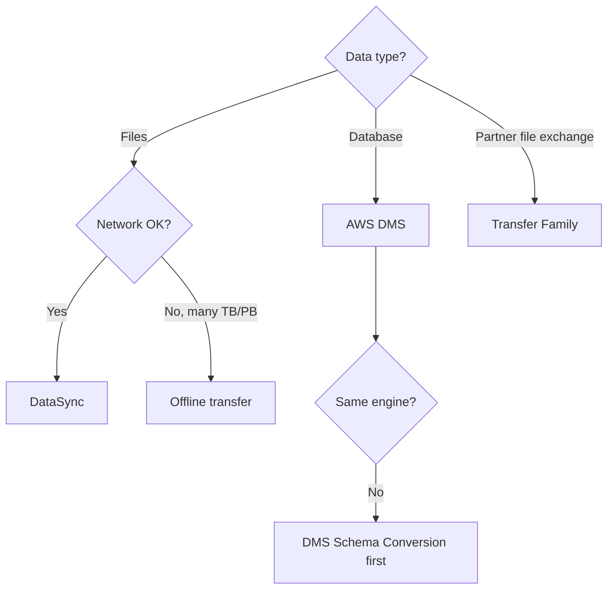

# 11.1. Data Migration

- [Data migration services on AWS](#data-migration-services-on-aws)
- [AWS DMS](#aws-dms)
- [DMS Schema Conversion](#dms-schema-conversion)
- [AWS DataSync](#aws-datasync)
- [AWS Transfer Family](#aws-transfer-family)
- [Offline transfer: Snow Family and Data Transfer Terminal](#offline-transfer-snow-family-and-data-transfer-terminal)
- [Database migration paths](#database-migration-paths)
- [Migrating Hadoop and Spark to EMR](#migrating-hadoop-and-spark-to-emr)
- [Data warehouse migration to Redshift](#data-warehouse-migration-to-redshift)

---

## Data migration services on AWS

| Data to move | AWS service |
|---|---|
| Databases | AWS DMS, DMS Schema Conversion |
| Files and objects (online) | AWS DataSync, S3 CLI, S3 Transfer Acceleration |
| SFTP, FTPS, FTP, AS2 | AWS Transfer Family |
| Very large data (offline) | AWS Data Transfer Terminal, Snowball Edge (existing customers) |
| Hadoop and Spark | Amazon EMR, DataSync for HDFS |
| Data warehouses | DMS Schema Conversion, AWS SCT, Redshift |

## AWS DMS

- DMS migrates databases to AWS. The source stays online.
- Migration types:
  - **Full load:** copy all existing data.
  - **Full load + CDC:** copy data, then replicate changes.
  - **CDC only:** replicate changes.
- Homogeneous: same engine, for example MySQL to Aurora MySQL.
- Heterogeneous: different engines, for example Oracle to Aurora PostgreSQL.
- Targets include RDS, Aurora, Redshift, S3, DynamoDB, Kinesis, OpenSearch, and DocumentDB.
- Use **DMS Serverless** to remove capacity planning.
- Use **data validation** to compare source and target rows.
- Use **DMS Fleet Advisor** to find and inventory on-premises databases.

## DMS Schema Conversion

- Schema Conversion changes schema and code objects between engines.
- It is part of the DMS console. It replaces most uses of the AWS SCT desktop tool.
- It makes an assessment report of conversion complexity.
- It can use generative AI to convert more code objects.
- Use AWS SCT for data warehouse sources that Schema Conversion does not support.

## AWS DataSync

- DataSync moves files and objects online. It is fast and encrypted.
- Sources: NFS, SMB, HDFS, object storage, other clouds, and AWS storage.
- Targets: S3, EFS, FSx (all types).
- An agent runs on premises. Agentless transfer is available between AWS services and for some clouds.
- DataSync verifies data integrity and supports schedules and bandwidth limits.

## AWS Transfer Family

- Transfer Family gives managed SFTP, FTPS, FTP, and AS2 servers.
- Storage: S3 or EFS.
- Use it for file exchange with partners.
- Managed workflows process files after upload.
- Web apps give a browser interface for S3 access.

## Offline transfer: Snow Family and Data Transfer Terminal

- AWS Snowball Edge is not available to new customers since November 2025.
- Snowcone and Snowmobile are retired.
- **AWS Data Transfer Terminal** is a physical location. You bring your storage devices and upload at high speed.
- For online alternatives, use DataSync or AWS Direct Connect.

## Database migration paths

| Source | Target | Tool |
|---|---|---|
| MySQL, PostgreSQL | RDS or Aurora | Native dump, DMS, Aurora read replica from RDS |
| Oracle, SQL Server | RDS same engine | Native backup and restore, DMS |
| Oracle, SQL Server | Aurora PostgreSQL | Schema Conversion + DMS |
| MongoDB | DocumentDB | DMS, native tools |
| Cassandra | Amazon Keyspaces | DMS, cqlsh COPY |
| Any database | S3 data lake | DMS with CDC to S3 |

- Use AWS Migration Hub and AWS Application Migration Service for server rehosting.

## Migrating Hadoop and Spark to EMR

- Move HDFS data to S3 with DataSync or `S3DistCp`.
- Use S3 as persistent storage. Use EMR clusters as temporary compute.
- Move the Hive metastore to the AWS Glue Data Catalog.
- Select a deployment: EMR on EC2, EMR on EKS, or EMR Serverless.
- Use Spot Instances for task nodes to reduce cost.

## Data warehouse migration to Redshift

- Assess the source with Schema Conversion or AWS SCT.
- Convert the schema and SQL code.
- Extract data with SCT data extraction agents or DMS.
- Load the data from S3 with the `COPY` command.
- Validate the results and switch reports to Redshift.
