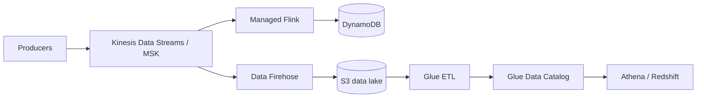

# 11.2. Ingestion and processing

- [Ingestion and processing services on AWS](#ingestion-and-processing-services-on-aws)
- [Batch and streaming patterns](#batch-and-streaming-patterns)
- [Amazon Kinesis Data Streams](#amazon-kinesis-data-streams)
- [Amazon Data Firehose](#amazon-data-firehose)
- [Amazon Managed Service for Apache Flink](#amazon-managed-service-for-apache-flink)
- [Amazon MSK](#amazon-msk)
- [AWS Glue](#aws-glue)
- [Amazon EMR](#amazon-emr)
- [AWS Lambda for data](#aws-lambda-for-data)
- [Zero-ETL integrations](#zero-etl-integrations)
- [Change data capture (CDC)](#change-data-capture-cdc)
- [Retry and error handling](#retry-and-error-handling)

---

## Ingestion and processing services on AWS

| Need | AWS service |
|---|---|
| Real-time event stream | Kinesis Data Streams, Amazon MSK |
| Deliver a stream to storage | Amazon Data Firehose |
| Stream processing | Managed Service for Apache Flink, Lambda |
| Serverless batch ETL | AWS Glue |
| Big data clusters (Spark, Hive, Presto) | Amazon EMR |
| Database to warehouse without pipelines | Zero-ETL integrations |
| Database CDC | AWS DMS, Debezium on MSK Connect |

## Batch and streaming patterns

| Item | Batch | Streaming |
|---|---|---|
| Latency | Minutes to hours | Milliseconds to seconds |
| Services | Glue, EMR, Redshift `COPY` | Kinesis, MSK, Flink, Firehose |
| Trigger | Schedule or event | Continuous |

## Amazon Kinesis Data Streams

- Kinesis Data Streams stores ordered records in shards.
- Capacity modes: **on-demand** or **provisioned**.
- One provisioned shard accepts 1 MB/s or 1,000 records/s for writes.
- Each shard gives 2 MB/s of reads. Use **enhanced fan-out** for 2 MB/s for each consumer.
- Retention: 24 hours default, up to 365 days.
- The partition key selects the shard. Records with one key stay in order.
- Producers: SDK, Kinesis Producer Library (KPL), Kinesis Agent.
- Consumers: Kinesis Client Library (KCL), Lambda, Flink, Firehose.
- A hot partition key causes throttling. Use a key with high cardinality.

## Amazon Data Firehose

- Firehose delivers streaming data to destinations. It is fully managed.
- Destinations: S3, Redshift, OpenSearch, Splunk, Snowflake, Apache Iceberg tables, HTTP endpoints.
- Firehose buffers by size or by time.
- It can change JSON to Parquet or ORC with a Glue table schema.
- It can transform records with Lambda.
- It supports dynamic partitioning in S3.
- Firehose is near real time, not real time.

## Amazon Managed Service for Apache Flink

- It runs Apache Flink applications without servers.
- Use it for windowed aggregations, joins, and anomaly detection on streams.
- Sources and sinks: Kinesis, MSK, S3, and others.
- Write applications in Java, Scala, Python, or SQL.
- Use Flink Studio notebooks for interactive queries.

## Amazon MSK

- MSK is managed Apache Kafka.
- Types: **MSK Provisioned** (Standard or Express brokers) and **MSK Serverless**.
- **MSK Connect** runs Kafka Connect connectors, for example Debezium.
- Use MSK when you need Kafka APIs or migrate existing Kafka workloads.

## AWS Glue

- **Glue ETL jobs:** serverless Spark (Python or Scala) and Python shell jobs.
- **Glue Studio:** visual job editor.
- **Crawlers:** scan data in S3 and databases. They make tables in the Data Catalog.
- **Data Catalog:** a central Hive-compatible metastore for Athena, EMR, and Redshift Spectrum.
- **Job bookmarks:** process only new data in each run.
- **Glue Data Quality:** rules in DQDL that check data in jobs and in the catalog.
- **Glue DataBrew:** no-code data preparation.
- **Glue Streaming ETL:** Spark streaming from Kinesis or Kafka.
- **Workflows and triggers:** chain crawlers and jobs.
- Glue supports Apache Iceberg, Hudi, and Delta Lake formats.

## Amazon EMR

| Deployment | Use when |
|---|---|
| EMR on EC2 | You need full cluster control and custom software. |
| EMR on EKS | You run Spark on an existing Kubernetes platform. |
| EMR Serverless | You want Spark or Hive without cluster management. |

- EMR on EC2 node types: primary, core (HDFS), and task (compute only).
- Use Spot Instances for task nodes.
- Use EMRFS to read and write S3 direct.
- Use transient clusters for batch jobs to reduce cost.

## AWS Lambda for data

- Lambda processes events from S3, Kinesis, DynamoDB Streams, SQS, and MSK.
- Maximum run time is 15 minutes.
- Use Lambda for light transforms. Use Glue or EMR for large jobs.

## Zero-ETL integrations

- Zero-ETL replicates data without a pipeline that you build.
- Sources to Redshift: Aurora MySQL, Aurora PostgreSQL, RDS for MySQL, DynamoDB, and some SaaS applications.
- DynamoDB to OpenSearch Service.
- Data arrives in near real time.

## Change data capture (CDC)

- **DMS:** CDC from relational databases to S3, Kinesis, Redshift, and others.
- **DynamoDB Streams:** item-level changes for 24 hours.
- **Kinesis Data Streams for DynamoDB:** longer retention and more consumers.
- **Debezium on MSK Connect:** CDC to Kafka topics.
- Use Apache Iceberg tables to apply upserts in the data lake.

## Retry and error handling

- Use exponential backoff with jitter for API calls. AWS SDKs do this by default.
- Use dead-letter queues (SQS) for failed Lambda events.
- For stream sources, set Lambda `MaximumRetryAttempts`, `BisectBatchOnFunctionError`, and an on-failure destination.
- Firehose writes failed records to an S3 error prefix.
- Use idempotent writes, because many services deliver at least once.
- Set Glue job retries and timeouts.
