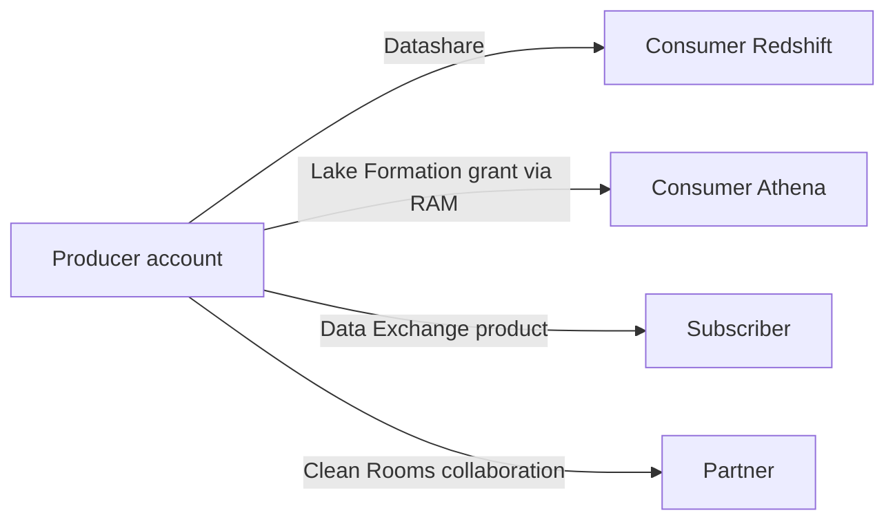

# 11.4. Sharing data

- [Data sharing services on AWS](#data-sharing-services-on-aws)
- [Redshift data sharing](#redshift-data-sharing)
- [Lake Formation cross-account sharing](#lake-formation-cross-account-sharing)
- [AWS Data Exchange](#aws-data-exchange)
- [AWS Clean Rooms](#aws-clean-rooms)
- [S3 file-based sharing](#s3-file-based-sharing)

---

## Data sharing services on AWS

| Need | AWS service |
|---|---|
| Live warehouse data across clusters or accounts | Redshift data sharing |
| Data lake tables across accounts | Lake Formation, AWS RAM |
| Buy or sell third-party data | AWS Data Exchange |
| Joint analysis without raw data exposure | AWS Clean Rooms |
| Share files | S3 access points, bucket policies, presigned URLs |
| Business data catalog with requests | SageMaker Catalog (Amazon DataZone) |

## Redshift data sharing

- Data sharing gives live read access. Redshift does not copy the data.
- Share across clusters, workgroups, accounts, and Regions.
- The producer creates a datashare. The consumer creates a database from it.
- Consumers use their own compute. Producer performance does not change.
- Multi-data warehouse writes let consumers also write to shared databases.

## Lake Formation cross-account sharing

- Lake Formation shares Data Catalog databases and tables with other accounts.
- Lake Formation uses AWS RAM for the share.
- **Tag-based access control (LF-TBAC)** scales grants with LF-Tags.
- Consumers make a resource link. Then they query with Athena, Redshift, or EMR.
- Row-level and column-level filters apply to shared data.

## AWS Data Exchange

- Data Exchange lets you find, subscribe to, and use third-party data.
- Delivery types: S3 files, Redshift datashares, APIs, S3 data access, and Lake Formation tables.
- Providers publish data products. Subscribers pay in AWS Marketplace.

## AWS Clean Rooms

- Clean Rooms lets partners analyze combined data. No partner sees the raw data of another.
- Each member sets analysis rules: aggregation, list, or custom.
- **Clean Rooms ML** trains lookalike models on combined data.
- **Differential privacy** adds noise to protect individual records.
- Data stays in S3, Athena, Redshift, or Snowflake.

## S3 file-based sharing

- **Bucket policies:** give access to other accounts.
- **S3 Access Points:** one policy for each application or team.
- **Presigned URLs:** temporary access to one object. Maximum 7 days with IAM user keys.
- **S3 Access Grants:** map corporate identities to S3 prefixes.
- **Cross-Region replication:** copy data to the bucket of another team.
- Set **Object Ownership** to "Bucket owner enforced" to disable ACLs.
