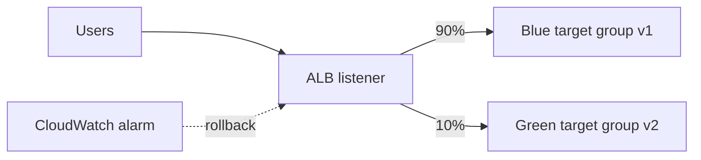
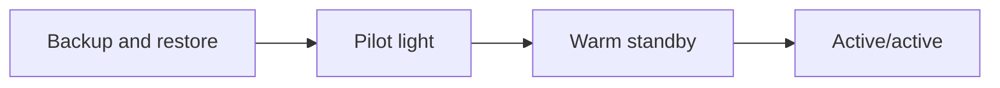

# 12.2. Design and cost optimization

- [Designing Reliable Systems](#designing-reliable-systems)
- [Microservices](#microservices)
- [Deployment Strategies](#deployment-strategies)
- [Disaster Recovery Strategies](#disaster-recovery-strategies)
- [Managing Versions and Configuration](#managing-versions-and-configuration)
- [Security in Design](#security-in-design)
- [Cost Planning Tools](#cost-planning-tools)
- [Cost Optimization Practices](#cost-optimization-practices)
- [Capacity Planning](#capacity-planning)
- [Managing Multiple Environments](#managing-multiple-environments)

---

## Designing Reliable Systems

- Deploy across at least two Availability Zones.
- Use Elastic Load Balancing and Auto Scaling groups.
- Use managed services with Multi-AZ options: RDS Multi-AZ, Aurora, DynamoDB, S3.
- Decouple components with SQS, SNS and EventBridge.
- Use retries with exponential backoff and jitter.
- Use timeouts and circuit breakers.
- Use cell-based architecture to limit the blast radius.
- Use Route 53 health checks and failover routing.
- Use Application Recovery Controller zonal shift to move traffic away from an AZ.

## Microservices

- Each service owns its data and deploys independently.
- Compute options: ECS, EKS, Lambda.
- Communication:
  - Synchronous: API Gateway, ALB, VPC Lattice.
  - Asynchronous: SQS, SNS, EventBridge, Kinesis.
- Service discovery: AWS Cloud Map, ECS Service Connect, VPC Lattice.
- Use X-Ray and Application Signals to trace calls between services.

## Deployment Strategies

| Strategy | Description | AWS support |
|---|---|---|
| All at once | Update all targets together. Fast, high risk. | CodeDeploy, Beanstalk |
| Rolling | Update targets in batches. | CodeDeploy, ECS, Beanstalk, ASG instance refresh |
| Immutable | Create new instances, then replace old instances. | Beanstalk |
| Blue/green | Run two environments. Move traffic to green. | CodeDeploy, ECS, Route 53, ALB |
| Canary | Send a small percentage of traffic first. | CodeDeploy, API Gateway, Lambda aliases |
| Linear | Move traffic in equal steps. | CodeDeploy for Lambda and ECS |
| Feature flags | Turn features on without a deployment. | AWS AppConfig |

## Disaster Recovery Strategies

- Recovery time objective (RTO): the maximum time to restore the service.
- Recovery point objective (RPO): the maximum data loss in time.

| Strategy | RTO / RPO | Cost | Description |
|---|---|---|---|
| Backup and restore | Hours | Lowest | AWS Backup copies to another Region |
| Pilot light | Tens of minutes | Low | Core data replicated. Compute off. |
| Warm standby | Minutes | Medium | Smaller full copy runs in a second Region |
| Multi-site active/active | Near zero | Highest | Full traffic in two or more Regions |

- Services: AWS Backup, AWS Elastic Disaster Recovery, S3 Cross-Region Replication, Aurora Global Database, DynamoDB global tables, Route 53 ARC.

## Managing Versions and Configuration

- Use semantic versioning for APIs and packages.
- Use API Gateway stages or paths for API versions.
- Use Lambda versions and aliases.
- Keep configuration in AppConfig or Parameter Store. Keep secrets in Secrets Manager.
- Tag ECR images with immutable tags.

## Security in Design

- Use least-privilege IAM roles for each service.
- Encrypt data with KMS at rest and TLS in transit.
- Put workloads in private subnets. Use VPC endpoints for AWS services.
- Protect public endpoints with AWS WAF and AWS Shield.
- Use Security Hub and GuardDuty to find threats.

## Cost Planning Tools

| Tool | Purpose |
|---|---|
| AWS Pricing Calculator | Estimate the cost of a planned architecture |
| Cost Explorer | Analyze and forecast spend |
| AWS Budgets | Alerts and actions on cost, usage and commitments |
| Cost Anomaly Detection | ML alerts for unusual spend |
| Data Exports (CUR 2.0) | Detailed billing data to S3. Query with Athena. |
| Cost allocation tags | Group costs by team, project or environment |
| Cost Optimization Hub | One place for savings recommendations |
| Trusted Advisor | Checks for cost, security, reliability, performance and limits |
| Compute Optimizer | Right-size compute and storage |
| Billing and Cost Management (Organizations) | Consolidated billing, cost categories |

## Cost Optimization Practices

- Right-size resources with Compute Optimizer.
- Purchase commitments for steady load:
  - Compute Savings Plans: EC2, Fargate and Lambda. Up to 66% off.
  - EC2 Instance Savings Plans: one instance family in one Region. Up to 72% off.
  - Reserved Instances: RDS, ElastiCache, OpenSearch, Redshift and EC2.
- Use Spot Instances for fault-tolerant work. Up to 90% off.
- Use Graviton instances for better price performance.
- Use serverless services to pay only for use.
- Use S3 storage classes and S3 Intelligent-Tiering.
- Use S3 life cycle rules to move or delete old data.
- Stop development resources outside work hours with Instance Scheduler.
- Decrease data transfer: use VPC endpoints, CloudFront and the same AZ when possible.
- Delete unused EBS volumes, snapshots and Elastic IP addresses.

## Capacity Planning

- Use CloudWatch history and Auto Scaling predictive scaling.
- Check Service Quotas before launches. Request increases early.
- Use On-Demand Capacity Reservations for critical events.
- Use Capacity Blocks for ML to reserve GPU instances.
- Run load tests before peak events.

## Managing Multiple Environments

- Use a separate AWS account for each environment: dev, test, staging, prod.
- Use AWS Organizations and Control Tower to manage accounts.
- Use service control policies (SCPs) to limit actions in each OU.
- Use IAM Identity Center for single sign-on to all accounts.
- Deploy the same IaC templates with different parameters for each environment.
- Use CodePipeline cross-account deployments or CloudFormation StackSets.
- Create temporary environments for pull requests. Delete them after the merge.
- Tag resources with the environment name for cost and access control.
