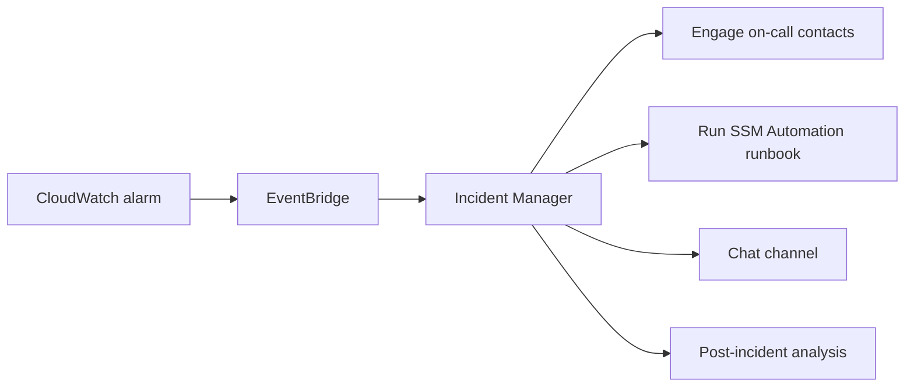

# 12.1. Site Reliability Engineering (SRE)

- [Site Reliability Engineering (SRE)](#site-reliability-engineering-sre)
- [SLIs, SLOs and Error Budgets](#slis-slos-and-error-budgets)
- [Reduce Organizational Silos](#reduce-organizational-silos)
- [Incident Management](#incident-management)
- [Blameless Postmortem](#blameless-postmortem)
- [Implement Gradual Change](#implement-gradual-change)
- [Resilience Testing](#resilience-testing)
- [Leverage Tooling and Automation](#leverage-tooling-and-automation)
- [Measure Everything](#measure-everything)
- [AWS Well-Architected Framework](#aws-well-architected-framework)

---

## Site Reliability Engineering (SRE)

- SRE uses software engineering to operate reliable systems.
- The table maps SRE practices to AWS services.

| SRE practice | AWS services |
|---|---|
| Define SLOs | CloudWatch Application Signals |
| Monitor and alert | CloudWatch, X-Ray, Managed Grafana |
| Respond to incidents | Systems Manager Incident Manager, AWS Health, AWS Chatbot (Amazon Q Developer in chat apps) |
| Analyze incidents | CloudWatch investigations, Incident Manager post-incident analysis |
| Release safely | CodeDeploy, CodePipeline, AppConfig |
| Test resilience | Fault Injection Service, Resilience Hub |
| Remove toil | Systems Manager Automation, Lambda, EventBridge |
| Review architecture | Well-Architected Tool |

## SLIs, SLOs and Error Budgets

- A service level indicator (SLI) measures behavior, for example latency or availability.
- A service level objective (SLO) is a target for an SLI, for example 99.9%.
- An error budget is the allowed failure: 100% minus the SLO.
- CloudWatch Application Signals creates SLOs on service operations or CloudWatch metrics.
- It shows the attainment and the remaining error budget.
- Set burn rate alarms to warn before the budget is empty.
- When the error budget is empty, stop feature releases and fix reliability.

## Reduce Organizational Silos

- Developers and operators share ownership of production.
- Use shared dashboards in CloudWatch or Managed Grafana.
- Use cross-account observability to give one view of all accounts.
- Keep runbooks in Systems Manager documents.

## Incident Management

- Systems Manager Incident Manager gives response plans, on-call schedules, escalations and runbooks.
- AWS closed Incident Manager to new customers. Existing customers can continue to use it. Check the current status.
- Alternatives: CloudWatch investigations and partner tools, for example PagerDuty.
- AWS Health sends events about AWS issues that affect your resources.
- AWS Support plans give access to AWS engineers. Enterprise plans include incident detection and response.

## Blameless Postmortem

- A postmortem finds the root cause. It does not blame people.
- Record the timeline, impact, root cause and action items.
- Use the "five whys" method to find the root cause.
- Use CloudTrail, CloudWatch Logs and X-Ray traces as evidence.
- Use the Correction of Error (COE) template from AWS practices.

## Implement Gradual Change

- Small changes decrease risk and make rollback easier.
- AWS services for gradual change:
  - CodeDeploy canary and linear deployments for Lambda and ECS.
  - Lambda alias weighted traffic.
  - AWS AppConfig feature flags with gradual deployment and automatic rollback.
  - CloudFormation rollback triggers.
  - Route 53 weighted routing.
- Deploy to one Region or one cell first. Then deploy to the others.

## Resilience Testing

- AWS Fault Injection Service (FIS) runs chaos experiments.
- Faults: stop instances, add latency, stop AZ network traffic, throttle APIs, stress CPU.
- Stop conditions use CloudWatch alarms to end an experiment.
- AWS Resilience Hub measures resilience against RTO and RPO targets.
- Resilience Hub gives recommendations and runs assessments in CI/CD.
- Amazon Application Recovery Controller (ARC) gives zonal shift and Region failover controls.

## Leverage Tooling and Automation

- Toil is manual, repetitive work. SRE teams decrease toil.
- Use Systems Manager Automation for runbooks.
- Use EventBridge rules to start automatic remediation.
- Use AWS Config remediation to fix noncompliant resources.
- Use Auto Scaling to remove manual capacity work.
- Use Amazon Q Developer to help investigate operational issues.

## Measure Everything

- Monitor the four golden signals: latency, traffic, errors and saturation.
- Use CloudWatch metrics and Application Signals for service metrics.
- Use Synthetics canaries to measure availability from the user view.
- Use RUM to measure real user experience.
- Track deployment metrics: frequency, lead time, change failure rate and recovery time (DORA).

## AWS Well-Architected Framework

- The framework has six pillars:
  - Operational excellence.
  - Security.
  - Reliability.
  - Performance efficiency.
  - Cost optimization.
  - Sustainability.
- The Well-Architected Tool reviews workloads against the pillars.
- Lenses add guidance for special workloads, for example serverless, ML and generative AI.
