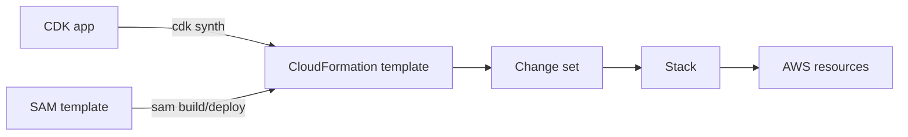
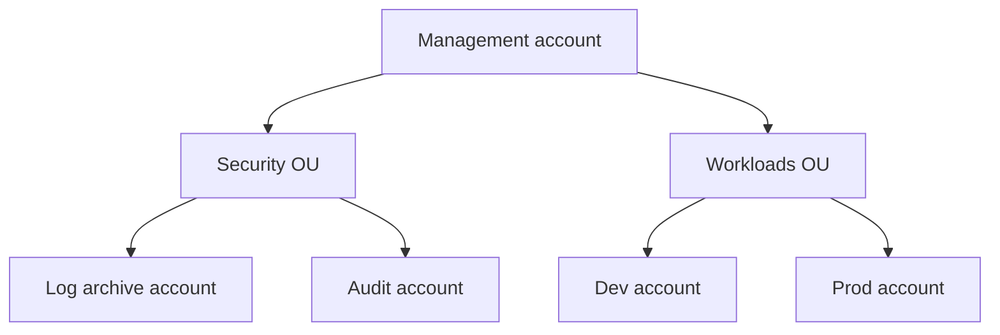

# 8. Infrastructure management

- [Infrastructure as Code (IaC)](#infrastructure-as-code-iac)
- [AWS CloudFormation](#aws-cloudformation)
- [AWS CDK](#aws-cdk)
- [AWS SAM](#aws-sam)
- [Terraform on AWS](#terraform-on-aws)
- [AWS Service Catalog](#aws-service-catalog)
- [AWS Control Tower and AFT](#aws-control-tower-and-aft)
- [AWS Systems Manager](#aws-systems-manager)
- [AWS Proton](#aws-proton)
- [GitOps on EKS](#gitops-on-eks)

---

## Infrastructure as Code (IaC)

- IaC defines infrastructure in files. You keep the files in version control.
- IaC gives repeatable, reviewed and tested changes.

| Tool | Language | State | Use it for |
|---|---|---|---|
| CloudFormation | YAML or JSON | AWS manages | AWS-native IaC |
| CDK | TypeScript, Python, Java, C#, Go | CloudFormation | IaC with programming languages |
| SAM | YAML (CloudFormation extension) | CloudFormation | Serverless applications |
| Terraform | HCL | State file (for example S3) | Multi-cloud IaC |

## AWS CloudFormation

- A template defines resources. A stack is a deployed template.
- Template sections: Parameters, Mappings, Conditions, Resources, Outputs.
- Change sets show changes before you apply them.
- Drift detection finds manual changes to stack resources.
- Rollback triggers use CloudWatch alarms to roll back a failed update.
- StackSets deploy stacks to many accounts and Regions.
- Nested stacks reuse common templates.
- Stack policies and termination protection prevent accidental changes.
- `DeletionPolicy: Retain` keeps a resource after stack deletion.
- Hooks and CloudFormation Guard check templates against rules.
- Custom resources run Lambda code for unsupported actions.
- IaC generator creates templates from existing resources.

## AWS CDK

- CDK defines infrastructure with programming languages.
- Constructs are reusable components. Levels: L1 (raw), L2 (defaults), L3 (patterns).
- `cdk synth` creates a CloudFormation template. `cdk deploy` deploys it.
- `cdk diff` shows changes. `cdk bootstrap` prepares an account and Region.
- CDK Pipelines creates a self-mutating CodePipeline.
- Use unit tests with the assertions module.

## AWS SAM

- SAM (Serverless Application Model) simplifies serverless templates.
- Resources: `AWS::Serverless::Function`, `Api`, `HttpApi`, `SimpleTable`, `StateMachine`.
- The SAM CLI builds, tests locally and deploys applications.
- `sam sync` sends changes quickly to a development stack.
- SAM supports gradual Lambda deployments with CodeDeploy.

## Terraform on AWS

- The AWS provider and AWS Cloud Control provider (`awscc`) manage AWS resources.
- Keep state in S3. Use S3 native state locking or a DynamoDB table for locks.
- Use modules for reuse. AWS publishes modules and blueprints (for example EKS Blueprints).
- Use OIDC roles for CI/CD runs.

## AWS Service Catalog

- Service Catalog lets administrators publish approved products.
- A product is a CloudFormation or Terraform template.
- A portfolio groups products and gives access to IAM principals.
- Constraints control launch roles, parameters and tags.
- Users deploy products without broad IAM permissions.

## AWS Control Tower and AFT

- Control Tower sets up a multi-account landing zone with AWS Organizations.
- It creates log archive and audit accounts.
- Controls (guardrails):
  - Preventive: service control policies.
  - Detective: AWS Config rules.
  - Proactive: CloudFormation hooks.
- Account Factory creates new accounts with a standard baseline.
- Account Factory for Terraform (AFT) creates and customizes accounts with Terraform pipelines.
- Customizations for Control Tower (CfCT) uses CloudFormation and SCPs.

## AWS Systems Manager

| Capability | Purpose |
|---|---|
| Session Manager | Shell access without SSH keys or open ports |
| Run Command | Run commands on many instances |
| Patch Manager | Patch OS and applications on a schedule |
| Automation | Runbooks for operational tasks |
| Parameter Store | Configuration values and secrets |
| State Manager | Keep instances in a defined state |
| Inventory | Collect software and configuration data |
| Fleet Manager | Manage nodes from the console |
| OpsCenter | Track operational issues (OpsItems) |

- Instances need the SSM Agent and an IAM instance profile.

## AWS Proton

- AWS announced the end of support for AWS Proton. Do not use it for new work. Check the AWS documentation for the dates.
- For new platform templates, use Service Catalog, CDK, Terraform modules or Backstage.

## GitOps on EKS

- GitOps keeps the desired cluster state in Git. A controller applies the state.
- Tools: Argo CD and Flux. EKS has a managed Argo CD capability.
- AWS Controllers for Kubernetes (ACK) manage AWS resources from Kubernetes.
- Helm packages Kubernetes applications. Kustomize changes manifests for each environment.
