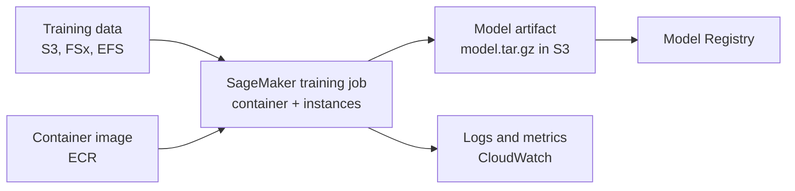

# 10.5. Custom Models Training

- [Training options on AWS](#training-options-on-aws)
- [SageMaker training jobs](#sagemaker-training-jobs)
- [Managed Spot Training](#managed-spot-training)
- [Distributed training](#distributed-training)
- [SageMaker HyperPod](#sagemaker-hyperpod)
- [Automatic Model Tuning](#automatic-model-tuning)
- [SageMaker Feature Store](#sagemaker-feature-store)
- [Training outside SageMaker](#training-outside-sagemaker)
- [SQL-based ML](#sql-based-ml)
- [Frameworks and containers](#frameworks-and-containers)

---

## Training options on AWS

| Option | Use when |
|---|---|
| SageMaker training jobs | Managed, temporary compute for each job |
| SageMaker HyperPod | Long, large-scale training on a persistent cluster |
| Amazon EKS or AWS Batch | You already run Kubernetes or batch jobs |
| Amazon EMR | Spark ML on big data |
| Redshift ML / Athena ML | SQL users train or call models |

## SageMaker training jobs

A training job starts instances, runs your code, saves the model to S3, and stops the instances.

| Mode | Description |
|---|---|
| Built-in algorithm | Use an AWS algorithm. Supply only data and hyperparameters. |
| Script mode | Supply your Python script. AWS supplies the framework container. |
| Bring your own container (BYOC) | Supply your own Docker image in Amazon ECR. |

**Data input modes**

| Mode | Description |
|---|---|
| File | Copies data to the instance before training. |
| Fast File | Streams S3 data as files. No full copy. |
| Pipe | Streams data from S3. |
| FSx for Lustre / EFS | Mounts a file system for fast, shared access. |

- Use warm pools to keep instances ready between jobs.
- Use checkpoints in S3 to resume a stopped job.
- Use SageMaker Debugger and Profiler to find training problems.

## Managed Spot Training

- Set `use_spot_instances=True` and a `max_wait` time.
- Spot can reduce cost by up to 90% compared to On-Demand.
- AWS can stop Spot capacity. Save checkpoints to S3 to resume.

## Distributed training

| Library | Function |
|---|---|
| SageMaker distributed data parallel (SMDDP) | Fast AllReduce collectives for data parallel training |
| SageMaker model parallel (SMP) | Splits large models across GPUs. Supports tensor and pipeline parallelism. |
| PyTorch DDP and FSDP | Native PyTorch distribution on SageMaker |
| torchrun, MPI | Launchers supported by SageMaker |

- Use P5, P6, or Trn instances with EFA for multi-node training.
- Use heterogeneous clusters to use different instance types in one job.

## SageMaker HyperPod

- Gives a persistent cluster with Slurm or Amazon EKS.
- Replaces faulty nodes and resumes training automatically.
- Supports recipes for fine-tuning and pre-training popular models.
- Use HyperPod for training runs of days or weeks.

## Automatic Model Tuning

- Runs many training jobs with different hyperparameters.
- Selects the best job by one objective metric.

| Strategy | Description |
|---|---|
| Bayesian | Uses past results to select the next values. Default. |
| Random | Selects values at random. Supports high parallelism. |
| Grid | Tests all values. Categorical parameters only. |
| Hyperband | Stops weak jobs early. Good for long jobs. |

- Use warm start to continue from past tuning jobs.
- Use early stopping to reduce cost.

## SageMaker Feature Store

| Store | Use |
|---|---|
| Online store | Low-latency reads for real-time inference |
| Offline store | Historical data in S3 for training and batch. Query with Athena. |

- A feature group holds records with a record identifier and event time.
- Use point-in-time queries to prevent data leakage.
- Ingest data with the API, Data Wrangler, or streaming sources.

## Training outside SageMaker

| Service | Use |
|---|---|
| Amazon EMR | Spark MLlib on large datasets. EMR Studio gives notebooks. |
| Amazon EKS | Kubeflow, Ray, or custom training operators. |
| AWS Batch | Queued training jobs on EC2 or Fargate. Supports multi-node parallel jobs. |
| Amazon EC2 | Full control with DLAMI. |

## SQL-based ML

| Service | Function |
|---|---|
| Redshift ML | `CREATE MODEL` in SQL. Uses SageMaker Autopilot to train. Predictions run as SQL functions. |
| Athena ML | Calls a SageMaker endpoint from an Athena SQL query with `USING EXTERNAL FUNCTION`. |
| Aurora ML | Calls SageMaker and Bedrock from SQL in Aurora. |

## Frameworks and containers

| Framework | SageMaker support |
|---|---|
| PyTorch | Framework estimator and DLC. Most common choice. |
| TensorFlow / Keras | Framework estimator and DLC. |
| JAX | Supported through DLCs, BYOC, and Neuron on Trainium. |
| XGBoost | Built-in algorithm and framework container. |
| scikit-learn | Framework container for training and processing. |
| Hugging Face | Hugging Face DLCs for training and inference. |

- Use the SageMaker Python SDK to start jobs from Studio or a local machine.
