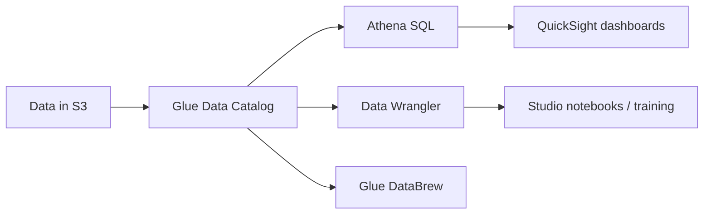

# 10.9. EDA and Reporting

- [EDA services on AWS](#eda-services-on-aws)
- [SageMaker Data Wrangler](#sagemaker-data-wrangler)
- [SageMaker notebooks](#sagemaker-notebooks)
- [Amazon Athena](#amazon-athena)
- [AWS Glue DataBrew](#aws-glue-databrew)
- [Amazon QuickSight](#amazon-quicksight)
- [SageMaker Unified Studio](#sagemaker-unified-studio)

---

## EDA services on AWS

| Need | Service |
|---|---|
| Visual EDA for ML data | SageMaker Data Wrangler (in Canvas) |
| Code-based EDA | SageMaker Studio notebooks |
| SQL on data in S3 | Amazon Athena |
| Data profiles for analysts | AWS Glue DataBrew |
| Business dashboards | Amazon QuickSight |
| One place for data, SQL, and ML | SageMaker Unified Studio |

## SageMaker Data Wrangler

- Data Wrangler is part of SageMaker Canvas.
- It imports data from S3, Athena, Redshift, Snowflake, and more.
- The Data Quality and Insights report shows:
  - Missing values and duplicates
  - Outliers and class imbalance
  - Target leakage
  - Quick model feature importance
- It gives visual analyses, for example histograms, scatter plots, and correlation.
- It gives more than 300 built-in transforms.
- You export the flow to a SageMaker Processing job, Pipeline, or Feature Store.
- You can use natural language to ask for transforms.

## SageMaker notebooks

- Use JupyterLab or Code Editor in SageMaker Studio.
- Use pandas, matplotlib, and seaborn for EDA.
- Use Amazon EMR or AWS Glue interactive sessions for Spark at scale.
- Use the SageMaker Python SDK to query Feature Store and Athena.

## Amazon Athena

- Athena is serverless SQL on data in S3.
- It uses the AWS Glue Data Catalog for table schemas.
- You pay for the data that each query scans.
- Use Parquet and partitions to reduce cost.
- Athena for Apache Spark runs notebooks for Spark-based EDA.

## AWS Glue DataBrew

- DataBrew is a visual tool for data cleaning and profiling.
- Profile jobs show statistics, missing values, and correlations.
- Recipes record transforms. You run recipes as jobs on full datasets.
- Data quality rules check data in profile jobs.

## Amazon QuickSight

- QuickSight is the AWS BI service. AWS now offers it as part of Amazon Quick Suite.
- It connects to Athena, Redshift, S3, RDS, and other sources.
- SPICE is an in-memory engine for fast dashboards.
- Amazon Q in QuickSight answers natural language questions and builds visuals.
- You can embed dashboards in applications.
- ML insights give anomaly detection and forecasts in visuals.

## SageMaker Unified Studio

- Unified Studio is part of the next generation of Amazon SageMaker.
- It gives one place for SQL, notebooks, data processing, and ML.
- It uses SageMaker Lakehouse to access S3 and Redshift data.
- It uses SageMaker Catalog (built on Amazon DataZone) for data discovery and governance.
- It includes Amazon Q Developer to help write SQL and code.
