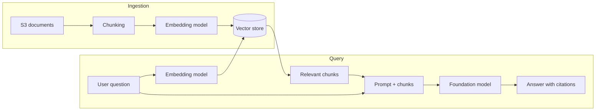

# 10.7. Generative AI and LLMs

- [Generative AI services on AWS](#generative-ai-services-on-aws)
- [Amazon Bedrock](#amazon-bedrock)
- [Bedrock models](#bedrock-models)
- [Bedrock inference options](#bedrock-inference-options)
- [Bedrock Knowledge Bases (RAG)](#bedrock-knowledge-bases-rag)
- [Vector stores](#vector-stores)
- [Bedrock Agents and AgentCore](#bedrock-agents-and-agentcore)
- [Prompt Management and Flows](#prompt-management-and-flows)
- [Model customization](#model-customization)
- [Bedrock Guardrails](#bedrock-guardrails)
- [SageMaker JumpStart and self-hosted models](#sagemaker-jumpstart-and-self-hosted-models)
- [Amazon Q and Kiro](#amazon-q-and-kiro)

---

## Generative AI services on AWS

| Need | AWS service |
|---|---|
| Call a foundation model with an API | Amazon Bedrock |
| Ground answers on company data | Bedrock Knowledge Bases |
| Build agents | Bedrock Agents, Bedrock AgentCore |
| Filter unsafe content | Bedrock Guardrails |
| Host open models yourself | SageMaker JumpStart, SageMaker endpoints, EKS |
| Ready-made assistant for employees | Amazon Q Business |
| Coding assistant | Amazon Q Developer, Kiro |

## Amazon Bedrock

- Bedrock is a fully managed service. It gives API access to foundation models (FMs).
- You do not manage servers.
- AWS does not use your prompts or outputs to train models.
- Your data stays in your selected Region, except with cross-Region inference.
- Use VPC endpoints (PrivateLink) for private access.
- Use IAM policies to control access to each model.
- Main APIs: `InvokeModel`, `Converse`, and their streaming versions.
- The `Converse` API gives one request format for all supported models.

## Bedrock models

- Amazon models: Amazon Nova (text, image, video, speech), Titan Embeddings.
- Third-party models: Anthropic Claude, Meta Llama, Mistral, Cohere, AI21, DeepSeek, Stability AI, and others.
- Bedrock Marketplace gives access to more specialized models.
- You must enable access to a model before first use, for some providers.
- Select a model on quality, latency, cost, context size, and modality.

## Bedrock inference options

| Option | Use when |
|---|---|
| On-demand | Pay per token. Variable traffic. |
| Batch inference | Large offline jobs from S3. Lower price than on-demand. |
| Provisioned Throughput | Guaranteed throughput. Required for most custom models. |
| Cross-Region inference | Bedrock routes requests across Regions for more capacity. |
| Latency-optimized inference | Lower latency for selected models. |
| Prompt caching | Repeated long prompt prefixes. Reduces cost and latency. |
| Intelligent prompt routing | Bedrock sends each prompt to a smaller or larger model in one family. |

## Bedrock Knowledge Bases (RAG)

- Knowledge Bases give a managed RAG workflow.
- Data sources: S3, web crawler, Confluence, SharePoint, Salesforce, and custom.
- Bedrock chunks the documents, makes embeddings, and stores them in a vector store.
- APIs:
  - `Retrieve` returns relevant chunks.
  - `RetrieveAndGenerate` returns an answer with citations.
- Structured data retrieval changes natural language to SQL for Redshift.
- GraphRAG uses Amazon Neptune Analytics.
- Bedrock Data Automation parses complex documents, images, audio, and video.

## Vector stores

| Vector store | Notes |
|---|---|
| OpenSearch Serverless | Default quick-create store for Knowledge Bases. |
| OpenSearch Service (managed clusters) | You control the cluster. |
| Aurora PostgreSQL (pgvector) | Use with existing relational data. |
| Amazon S3 Vectors | Low cost storage for large vector sets. |
| Neptune Analytics | Graph and vector search for GraphRAG. |
| MemoryDB | Very low latency vector search. |
| DocumentDB | Vector search in a document database. |
| Third party | Pinecone, Redis Enterprise Cloud, MongoDB Atlas. |

## Bedrock Agents and AgentCore

- **Bedrock Agents** are managed agents. They plan steps and call tools.
  - Action groups define tools with an OpenAPI schema and Lambda.
  - Agents can use Knowledge Bases.
  - Multi-agent collaboration lets a supervisor agent use other agents.
  - Return of control sends the tool call back to your application.
- **Bedrock AgentCore** runs agents built with any framework and any model.
  - Runtime: serverless and session-isolated agent hosting.
  - Memory: short-term and long-term memory.
  - Gateway: changes APIs and Lambda functions into MCP tools.
  - Identity: agent authentication with your identity provider.
  - Code Interpreter and Browser: managed tools.
  - Observability: traces and metrics in CloudWatch.

## Prompt Management and Flows

- **Prompt Management** stores, versions, and tests prompts.
- Prompts have variables. You can compare two prompt versions.
- **Bedrock Flows** connect prompts, models, Knowledge Bases, Lambda, and conditions in a visual workflow.
- You deploy a flow version with an alias.

## Model customization

| Method | Data | Use when |
|---|---|---|
| Fine-tuning | Labeled prompt and response pairs | Teach a task or style. |
| Continued pre-training | Unlabeled domain text | Teach domain vocabulary. |
| Distillation | Prompts. A teacher model makes responses. | Make a smaller and cheaper model act like a large model. |
| Reinforcement fine-tuning | Prompts and a reward function | Improve results with feedback. |

- Training data goes in S3.
- Custom models need Provisioned Throughput or on-demand inference, as each model supports.
- Custom Model Import lets you bring open-weight models (for example Llama, Mistral) into Bedrock.
- Prefer prompt engineering, then RAG, before customization.

## Bedrock Guardrails

- Guardrails apply safety rules to inputs and outputs.
- Policies: content filters, denied topics, word filters, PII filters, contextual grounding checks, and Automated Reasoning checks.
- Use guardrails with any model, through the `ApplyGuardrail` API.
- Refer to [Responsible AI](<Responsible AI.md>) for more data.

## SageMaker JumpStart and self-hosted models

- JumpStart is a model hub in SageMaker AI.
- You deploy open models to SageMaker endpoints with one click or one API call.
- You can fine-tune JumpStart models in your account.
- Use SageMaker HyperPod for large-scale training of FMs.
- Use EKS with vLLM or similar servers for full control.
- Use Trainium (Trn) and Inferentia (Inf) instances for lower cost.

## Amazon Q and Kiro

- **Amazon Q Business** is a generative AI assistant for employees.
  - It connects to company data with more than 40 connectors.
  - It respects source access controls.
  - Q Apps let users make small applications from prompts.
- **Amazon Q Developer** helps developers in the IDE, CLI, and AWS console.
  - It writes code, explains code, upgrades Java, and finds security issues.
- **Kiro** is an AWS agentic IDE. It uses spec-driven development: requirements, design, then tasks.
