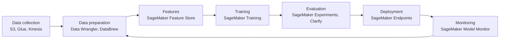
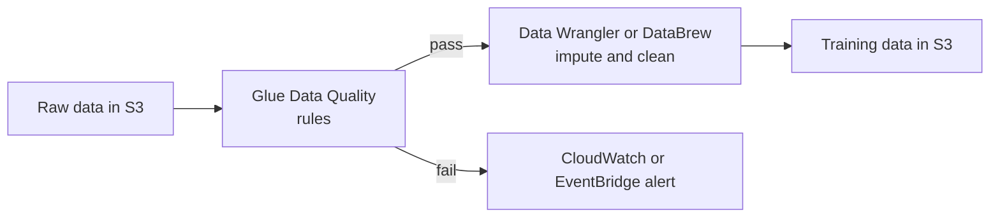

# 10.1. ML Methodologies

- [ML lifecycle on AWS](#ml-lifecycle-on-aws)
- [Problem types and SageMaker built-in algorithms](#problem-types-and-sagemaker-built-in-algorithms)
- [Metrics on AWS](#metrics-on-aws)
- [Missing values and data quality](#missing-values-and-data-quality)

---

## ML lifecycle on AWS

This section maps each lifecycle step to AWS services.

| Lifecycle step | AWS service |
|---|---|
| Store raw data | Amazon S3 |
| Label data | SageMaker Ground Truth |
| Prepare data | SageMaker Data Wrangler, AWS Glue DataBrew, AWS Glue |
| Store features | SageMaker Feature Store |
| Train models | SageMaker Training jobs |
| Tune hyperparameters | SageMaker Automatic Model Tuning |
| Track experiments | SageMaker Experiments, managed MLflow |
| Check bias | SageMaker Clarify |
| Deploy | SageMaker real-time, serverless, asynchronous, batch transform |
| Monitor | SageMaker Model Monitor, Amazon CloudWatch |

## Problem types and SageMaker built-in algorithms

SageMaker supplies built-in algorithms as containers. You select the algorithm and supply data in S3.

| Problem type | Built-in algorithms |
|---|---|
| Binary or multiclass classification | XGBoost, Linear Learner, LightGBM, CatBoost, AutoGluon-Tabular, TabTransformer, K-Nearest Neighbors |
| Regression | XGBoost, Linear Learner, LightGBM, CatBoost, K-Nearest Neighbors |
| Time-series forecasting | DeepAR, Chronos models in SageMaker Canvas and JumpStart |
| Recommendation | Factorization Machines |
| Clustering | K-Means |
| Dimension reduction | Principal Component Analysis (PCA) |
| Anomaly detection | Random Cut Forest (RCF), IP Insights |
| Topic modeling | Latent Dirichlet Allocation (LDA), Neural Topic Model (NTM) |
| Text classification and embeddings | BlazingText, Object2Vec |
| Translation and summarization | Sequence-to-Sequence |
| Image classification | Image Classification (MXNet, TensorFlow) |
| Object detection | Object Detection (MXNet, TensorFlow) |
| Image segmentation | Semantic Segmentation |

- Use SageMaker JumpStart for pre-trained models and fine-tuning.
- Use SageMaker Canvas when you do not want to write code.
- Use Amazon AI services when a pre-trained API solves the problem (see 10.3).

## Metrics on AWS

| Task | Where AWS computes metrics | Where you view metrics |
|---|---|---|
| Training metrics | Training job sends metrics to CloudWatch through regex metric definitions | CloudWatch, SageMaker Studio |
| Experiment compare | SageMaker Experiments, managed MLflow | Studio, MLflow UI |
| Model quality after deployment | SageMaker Model Monitor (model quality) | Studio, CloudWatch |
| Bias and explainability | SageMaker Clarify | Studio, Clarify reports in S3 |
| AutoML candidates | SageMaker Canvas (Autopilot) | Canvas leaderboard |
| Foundation model quality | Amazon Bedrock model evaluation, SageMaker Clarify FM evaluation | Bedrock console, Studio |

- Automatic Model Tuning uses one objective metric to select the best training job.
- Model Registry stores metrics with each model version.

## Missing values and data quality

| Need | AWS service | Notes |
|---|---|---|
| Impute missing values without code | SageMaker Data Wrangler (in Canvas) | Transforms: drop, fill with mean, median, mode, or custom value |
| Find data issues before training | Data Wrangler Data Quality and Insights report | Shows missing values, outliers, target leakage, duplicates |
| Clean data with visual recipes | AWS Glue DataBrew | 250+ transforms; profile jobs show missing-value counts |
| Validate data in pipelines | AWS Glue Data Quality | Rules in DQDL, for example `Completeness "col" > 0.95` |
| Detect drift in production data | SageMaker Model Monitor (data quality) | Compares live data to a baseline |
| Code-based imputation | SageMaker Processing jobs | Run scikit-learn or Spark scripts |

