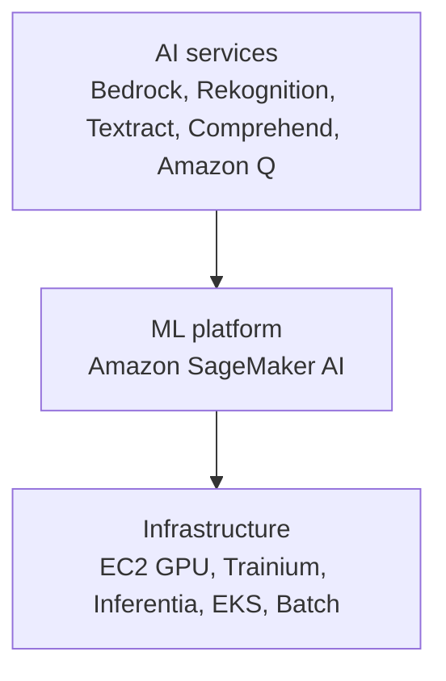

# 10.2. ML Infrastructures

- [AWS ML stack](#aws-ml-stack)
- [Accelerators](#accelerators)
- [Capacity options](#capacity-options)
- [SageMaker HyperPod](#sagemaker-hyperpod)
- [Development environments](#development-environments)
- [DLAMI and Deep Learning Containers](#dlami-and-deep-learning-containers)

---

## AWS ML stack

AWS arranges ML services in three layers.

| Layer | Use when | Effort |
|---|---|---|
| AI services | A pre-trained API or foundation model solves the problem | Low |
| SageMaker AI | You build, train, and deploy your own models | Medium |
| Infrastructure | You need full control of hardware, OS, and frameworks | High |

## Accelerators

| Instance family | Chip | Main use |
|---|---|---|
| P5, P5e, P5en | NVIDIA H100 / H200 | Large-scale training |
| P6 | NVIDIA Blackwell (B200, GB200) | Largest training and inference |
| P4d | NVIDIA A100 | Training |
| G6, G6e | NVIDIA L4 / L40S | Inference, small training, graphics |
| G5 | NVIDIA A10G | Inference, small training |
| Trn1, Trn2 | AWS Trainium | Low-cost training of large models |
| Inf2 | AWS Inferentia2 | Low-cost, high-throughput inference |

- AWS Neuron SDK compiles and runs models on Trainium and Inferentia.
- Neuron supports PyTorch and JAX.
- EC2 UltraClusters connect P and Trn instances with Elastic Fabric Adapter (EFA).
- EFA gives low-latency networking for distributed training.
- Use Amazon FSx for Lustre for fast training data access from S3.

## Capacity options

| Option | Description |
|---|---|
| On-Demand | Pay per second. No commitment. |
| Spot Instances | Use spare capacity at a discount. AWS can stop the instance. |
| EC2 Capacity Blocks for ML | Reserve GPU or Trainium instances for a fixed future period. |
| SageMaker training plans | Reserve capacity for SageMaker training jobs and HyperPod. |
| Savings Plans | Commit to usage for 1 or 3 years for a lower price. |
| On-Demand Capacity Reservations | Reserve capacity in an Availability Zone. |

## SageMaker HyperPod

- HyperPod gives persistent clusters for large training and inference.
- It uses Slurm or Amazon EKS for orchestration.
- It finds faulty nodes and replaces them automatically.
- It resumes jobs from the last checkpoint.
- HyperPod task governance shares compute between teams with quotas and priorities.

## Development environments

| Environment | Description |
|---|---|
| SageMaker Unified Studio | One studio for data, analytics, and AI. Part of the next generation of Amazon SageMaker. |
| SageMaker Studio | Web IDE for ML. Gives JupyterLab, Code Editor (VS Code based), and RStudio. |
| SageMaker Studio Lab | Free notebook environment for learning. |
| SageMaker notebook instances | Classic managed Jupyter on one EC2 instance. |
| EC2 with DLAMI | Self-managed instance with full control. |

- Studio spaces let you select instance type and stop compute when idle.
- Use lifecycle configurations to install packages at start.

## DLAMI and Deep Learning Containers

- AWS Deep Learning AMIs (DLAMI) include drivers, CUDA, and frameworks.
- AWS Deep Learning Containers (DLC) are Docker images for PyTorch, TensorFlow, and other frameworks.
- DLCs run on SageMaker, EC2, ECS, and EKS.
- SageMaker training and inference use DLCs by default.
- Neuron DLAMIs and DLCs support Trainium and Inferentia.
