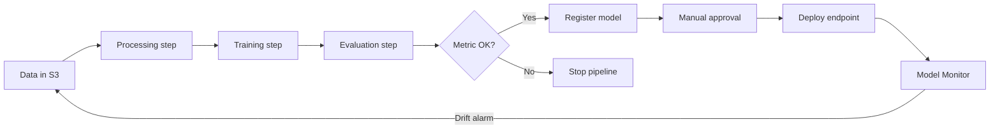

# 10.6. MLOps and Workflow Automation

- [MLOps services on AWS](#mlops-services-on-aws)
- [SageMaker Pipelines](#sagemaker-pipelines)
- [Experiment tracking](#experiment-tracking)
- [Model Registry](#model-registry)
- [SageMaker Projects and CI/CD for ML](#sagemaker-projects-and-cicd-for-ml)
- [Inference options](#inference-options)
- [Hosting many models](#hosting-many-models)
- [Deployment guardrails](#deployment-guardrails)
- [Inference optimization](#inference-optimization)
- [Model Monitor](#model-monitor)
- [Model evaluation](#model-evaluation)
- [Other orchestrators for ML](#other-orchestrators-for-ml)

---

## MLOps services on AWS

| ML component | AWS service |
|---|---|
| Pipeline orchestration | SageMaker Pipelines, Step Functions, Amazon MWAA |
| Experiment tracking | SageMaker managed MLflow |
| Model versions and approval | SageMaker Model Registry |
| CI/CD | SageMaker Projects, CodePipeline, CodeBuild, GitHub Actions |
| Serving | SageMaker endpoints, Batch Transform |
| Monitoring | SageMaker Model Monitor, CloudWatch |
| Evaluation | SageMaker Clarify, Bedrock evaluations |

## SageMaker Pipelines

- SageMaker Pipelines is a serverless workflow service for ML.
- You define a pipeline as a DAG of steps with the Python SDK or JSON.
- Step types:
  - Processing, Training, Tuning, Transform.
  - Model, RegisterModel, CreateModel.
  - Condition, Fail, Lambda, Callback, ClarifyCheck, QualityCheck, EMR, Notebook job.
- Use the `@step` decorator to change a Python function into a step.
- Pipelines cache step results. Enable caching to skip steps that did not change.
- Pipeline parameters let you change inputs at run time.
- Use EventBridge to start a pipeline on a schedule or on an event.
- Lineage tracking records the data, code, and model of each run.

## Experiment tracking

- SageMaker AI provides managed MLflow tracking servers.
- MLflow records parameters, metrics, and artifacts of each run.
- You can register MLflow models into the SageMaker Model Registry.
- SageMaker Experiments (classic) is replaced by managed MLflow in new Studio.

## Model Registry

- The Model Registry keeps a catalog of model versions.
- A model package group holds the versions of one model.
- Each version has an approval status: `PendingManualApproval`, `Approved`, or `Rejected`.
- A status change sends an EventBridge event. Use this event to start deployment.
- Model cards and metrics attach to each version.
- Share models across accounts with AWS RAM or resource policies.

## SageMaker Projects and CI/CD for ML

- SageMaker Projects create a full MLOps stack from a template.
- Templates use Service Catalog or custom templates.
- A typical template creates:
  - A source repository for the model build code.
  - A build pipeline that runs SageMaker Pipelines.
  - A deploy pipeline with staging and production stages.
- Use CodePipeline, CodeBuild, GitHub Actions, or Jenkins for the CI/CD part.
- Use separate AWS accounts for dev, staging, and production.

## Inference options

| Option | Use when | Notes |
|---|---|---|
| Real-time endpoint | Low latency, steady traffic | Auto scaling on instances. Payload up to 25 MB. |
| Serverless endpoint | Spiky or low traffic | No instance management. Cold starts. No GPU. |
| Asynchronous endpoint | Large payloads, long processing | Payload up to 1 GB. Up to 1 hour. Can scale to zero. |
| Batch Transform | Offline scoring of a full dataset | No persistent endpoint. Reads from and writes to S3. |

## Hosting many models

- **Multi-model endpoint (MME):** many models share one container. SageMaker loads models from S3 on demand.
- **Multi-container endpoint:** up to 15 different containers on one endpoint. Call them direct or as a serial pipeline.
- **Inference components:** you deploy many models to one endpoint. Each model has its own CPU, GPU, and memory share and its own scaling.
- **Serial inference pipeline:** chain preprocessing, prediction, and postprocessing containers.

## Deployment guardrails

- Deployment guardrails update real-time endpoints with safety controls.
- Blue/green traffic shift modes:
  - **All at once:** move all traffic to the new fleet.
  - **Canary:** move a small part first, then the rest.
  - **Linear:** move traffic in equal steps.
- Auto-rollback uses CloudWatch alarms. SageMaker reverts if an alarm fires.
- A rolling deployment updates the fleet in batches. It needs less extra capacity.
- **Shadow tests** send a copy of production traffic to a new variant. Users do not see shadow responses.
- **Production variants** let you split live traffic for A/B tests.

## Inference optimization

- **Inference Recommender** load tests instance types. It recommends the best cost and latency.
- **SageMaker Neo** compiles models for a target CPU, GPU, or edge device.
- **Inference optimization toolkit** applies quantization, speculative decoding, and compilation to generative models.
- Use AWS Inferentia instances (Inf2) for low cost inference.
- Use Auto Scaling with target tracking on `InvocationsPerInstance`.

## Model Monitor

- Model Monitor compares live data with a baseline from training.
- Monitor types:
  - **Data quality:** schema and statistics drift.
  - **Model quality:** accuracy against ground truth labels.
  - **Bias drift:** uses SageMaker Clarify.
  - **Feature attribution drift:** uses SageMaker Clarify SHAP values.
- Enable data capture on the endpoint first.
- Monitor jobs run on a schedule. Results go to S3 and CloudWatch.
- Use a CloudWatch alarm to start a retraining pipeline.

## Model evaluation

- **SageMaker Clarify** evaluates bias and explainability for tabular, text, and image models.
- **Foundation model evaluations (FMEval)** in SageMaker test accuracy, toxicity, and robustness of LLMs.
- **Amazon Bedrock evaluations** support:
  - Automatic evaluation with built-in metrics.
  - LLM-as-a-judge evaluation.
  - Human evaluation with your own work team.
  - RAG evaluation of Knowledge Bases.
- Add an evaluation step and a Condition step in the pipeline to gate registration.

## Other orchestrators for ML

| Service | Use when |
|---|---|
| AWS Step Functions | You combine ML with other AWS services. It has native SageMaker integration. |
| Amazon MWAA | Your team uses Apache Airflow already. |
| Kubeflow on EKS | You need a Kubernetes-native and portable platform. |
| SageMaker Pipelines | You want a serverless, ML-native pipeline with lineage. |
