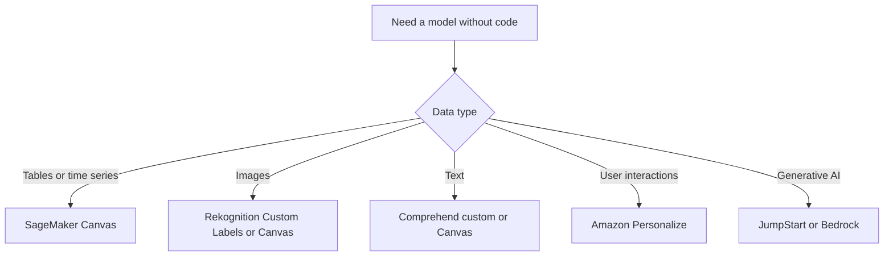

# 10.4. No-code Model Training

- [No-code options on AWS](#no-code-options-on-aws)
- [SageMaker Canvas](#sagemaker-canvas)
- [AutoML in Canvas (Autopilot)](#automl-in-canvas-autopilot)
- [SageMaker JumpStart](#sagemaker-jumpstart)
- [Rekognition Custom Labels](#rekognition-custom-labels)
- [Comprehend custom models](#comprehend-custom-models)
- [Amazon Personalize](#amazon-personalize)

---

## No-code options on AWS

| Need | Service |
|---|---|
| Tabular, time-series, image, or text models without code | SageMaker Canvas |
| Pre-trained or fine-tuned foundation models | SageMaker JumpStart, Amazon Bedrock |
| Custom image labels | Rekognition Custom Labels |
| Custom text classes or entities | Comprehend custom |
| Recommendations | Amazon Personalize |

## SageMaker Canvas

- Canvas is a visual, no-code ML workspace.
- It imports data from S3, Redshift, Athena, Snowflake, and other sources.
- It includes Data Wrangler for data preparation.
- It builds models for these problem types:
  - Binary and multiclass classification
  - Numeric prediction (regression)
  - Time-series forecasting
  - Single-label image classification
  - Multi-category text classification
- It gives ready-to-use models for sentiment, entities, language, object detection, and document analysis.
- It gives access to Bedrock and JumpStart foundation models for chat and fine-tuning.
- You can deploy models to SageMaker endpoints.
- You can register models to SageMaker Model Registry.

**Build modes**

| Mode | Description |
|---|---|
| Quick build | Fast build for a first check. |
| Standard build | Higher accuracy. Takes more time. Supports sharing with Studio. |

## AutoML in Canvas (Autopilot)

- SageMaker Autopilot is now part of Canvas.
- AutoML analyzes data, makes features, and tests many algorithms.
- It shows a leaderboard of candidate models with metrics.
- It shows feature importance and model explainability.
- You can use the `CreateAutoMLJobV2` API for AutoML with code.

## SageMaker JumpStart

- JumpStart is a hub of pre-trained models and solution templates.
- It includes foundation models from many providers.
- You deploy a model to an endpoint with a few clicks.
- You fine-tune many models with your own data in S3.
- Private model hubs let administrators control which models users can access.

## Rekognition Custom Labels

- Trains an image model on your own labels.
- You need only a small number of labeled images.
- It supports image classification and object detection.
- You start the model before use and stop it to stop charges.

## Comprehend custom models

| Type | Function |
|---|---|
| Custom classification | Puts documents into your own classes. Supports multi-class and multi-label. |
| Custom entity recognition | Finds your own entity types in text. |

- You supply training data in CSV or annotation files in S3.
- You use real-time endpoints or asynchronous jobs.

## Amazon Personalize

- You import interactions, items, and users datasets.
- You select a recipe or a domain use case, for example e-commerce or video.
- Personalize trains a solution version. You deploy it as a campaign.
- Use batch inference jobs for offline recommendations.
- Use filters to remove items, for example items that a user bought.
