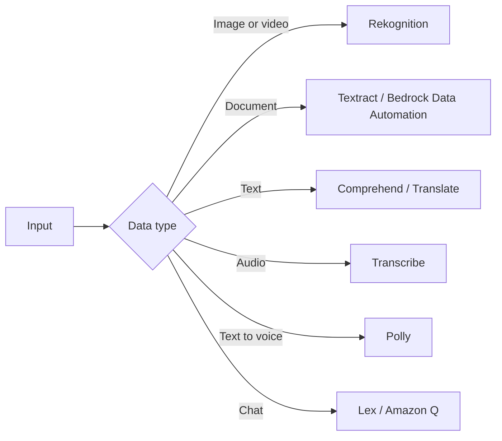

# 10.3. Pre-trained ML Models and APIs

- [Pre-trained AI services on AWS](#pre-trained-ai-services-on-aws)
- [Vision](#vision)
- [Documents](#documents)
- [Language and text](#language-and-text)
- [Speech](#speech)
- [Conversational AI and search](#conversational-ai-and-search)
- [Recommendations](#recommendations)
- [Generative AI services](#generative-ai-services)
- [Industry-specific AI](#industry-specific-ai)
- [Services closed to new customers](#services-closed-to-new-customers)

---

## Pre-trained AI services on AWS

- AI services are pre-trained APIs. You do not train or manage models.
- You call them with the AWS SDK, CLI, or console.
- Many services accept custom training data for better results.

## Vision

**Amazon Rekognition**

- Detects objects, scenes, faces, text, and unsafe content in images and video.
- Compares and searches faces in collections.
- Custom Labels trains models on your own images (see 10.4).
- Face Liveness checks that a real person is in front of the camera.

## Documents

**Amazon Textract**

- Extracts text, forms, tables, and signatures from scanned documents.
- Analyze Expense reads invoices and receipts.
- Analyze ID reads identity documents.
- Queries return answers to natural language questions about a document.

**Amazon Bedrock Data Automation**

- Extracts structured data from documents, images, audio, and video.
- Uses generative AI. You define output with blueprints.

## Language and text

| Service | Function |
|---|---|
| Amazon Comprehend | Sentiment, entities, key phrases, language, PII detection, topic modeling |
| Comprehend custom | Custom classification and custom entity recognition |
| Amazon Comprehend Medical | Extracts medical entities and links to ICD-10-CM, RxNorm, SNOMED CT |
| Amazon Translate | Neural machine translation. Supports custom terminology and batch jobs. |

## Speech

| Service | Function |
|---|---|
| Amazon Transcribe | Speech to text. Supports streaming, speaker labels, custom vocabulary, PII redaction. |
| Transcribe Call Analytics | Call sentiment, issues, and summaries for contact centers |
| AWS HealthScribe | Creates clinical notes from patient and clinician talks |
| Amazon Polly | Text to speech. Supports SSML, neural and generative voices. |

## Conversational AI and search

| Service | Function |
|---|---|
| Amazon Lex | Chatbots and voice bots with intents and slots. Integrates with Amazon Connect. |
| Amazon Kendra | Enterprise search with natural language. Can supply a retriever for RAG. |
| Amazon Connect | Cloud contact center with AI features |

## Recommendations

**Amazon Personalize**

- Gives real-time recommendations from your interaction data.
- Supplies recipes for user personalization, similar items, and ranking.
- You supply data. AWS trains and hosts the model.

## Generative AI services

| Service | Function |
|---|---|
| Amazon Bedrock | Foundation models through one API (see 10.7) |
| Amazon Q Business | Generative AI assistant for company data |
| Amazon Q Developer | AI assistant for code and AWS operations |
| Amazon Q in QuickSight | Natural language questions on dashboards |

## Industry-specific AI

| Service | Function |
|---|---|
| AWS HealthLake | FHIR data store with medical NLP |
| AWS HealthOmics | Store and process genomic data |
| AWS HealthImaging | Store and access medical images |

## Services closed to new customers

AWS closed these services to new customers. Existing customers can continue to use them for a period. Use the alternatives for new work.

| Service | Alternative |
|---|---|
| Amazon Forecast | SageMaker Canvas forecasting |
| Amazon Fraud Detector | SageMaker AI custom models |
| Amazon Lookout for Vision | SageMaker AI, Rekognition Custom Labels |
| Amazon Lookout for Equipment | SageMaker AI |
| Amazon Lookout for Metrics | SageMaker AI, CloudWatch anomaly detection |
| Amazon Monitron | SageMaker AI, AWS IoT SiteWise |

- Check the AWS product lifecycle page for current dates.
