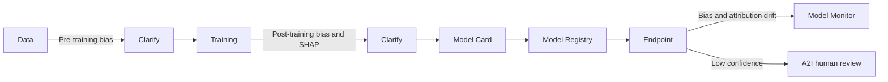

# 10.8. Responsible AI

- [Responsible AI services on AWS](#responsible-ai-services-on-aws)
- [SageMaker Clarify](#sagemaker-clarify)
- [Governance in SageMaker](#governance-in-sagemaker)
- [Amazon Augmented AI (A2I)](#amazon-augmented-ai-a2i)
- [Bedrock Guardrails](#bedrock-guardrails)
- [AI Service Cards](#ai-service-cards)
- [Privacy and security for ML](#privacy-and-security-for-ml)

---

## Responsible AI services on AWS

| Dimension | AWS service |
|---|---|
| Fairness and bias | SageMaker Clarify |
| Explainability | SageMaker Clarify |
| Documentation | SageMaker Model Cards, AI Service Cards |
| Governance | Model Dashboard, Role Manager, Model Registry |
| Human review | Amazon Augmented AI (A2I), SageMaker Ground Truth |
| Safety of generative AI | Bedrock Guardrails, Bedrock evaluations |
| Privacy | Amazon Macie, AWS KMS, Comprehend PII detection |
| Security | IAM, VPC, PrivateLink, CloudTrail |

## SageMaker Clarify

- Clarify detects bias in data and in models.
- **Pre-training bias metrics** examine the dataset. Examples: class imbalance (CI), difference in proportions of labels (DPL).
- **Post-training bias metrics** examine predictions. Examples: disparate impact (DI), difference in positive proportions in predicted labels (DPPL).
- **Explainability** uses SHAP values for feature attribution.
- Clarify gives partial dependence plots and computer vision and NLP explanations.
- Clarify runs as a processing job, in Data Wrangler, in Pipelines, or with Model Monitor.
- Clarify also evaluates foundation models for accuracy, toxicity, and stereotyping.

## Governance in SageMaker

- **Model Cards** record model purpose, training data, metrics, risk rating, and limitations.
  - Export a model card to PDF for auditors.
- **Model Dashboard** shows all models, endpoints, and monitor status in one view.
- **Role Manager** makes least-privilege IAM roles for ML personas.
- **Model Registry** records versions, lineage, and approval status.
- **Lineage tracking** links data, training jobs, and models.

## Amazon Augmented AI (A2I)

- A2I adds human review to ML predictions.
- Built-in integration with Textract and Rekognition.
- Custom integration with any model, through the A2I API.
- You set conditions, for example a confidence score below a threshold.
- Workforce options: Amazon Mechanical Turk, a vendor, or a private team.
- Use SageMaker Ground Truth for human labeling of training data.

## Bedrock Guardrails

| Policy | Function |
|---|---|
| Content filters | Block hate, insults, sexual, violence, misconduct, and prompt attacks. |
| Denied topics | Block topics that you define. |
| Word filters | Block words and profanity. |
| Sensitive information filters | Block or mask PII. Use regex for custom types. |
| Contextual grounding check | Detect hallucinations against a source and relevance to the query. |
| Automated Reasoning checks | Verify answers against formal rules from your policy documents. |
| Image content filters | Filter harmful images. |

- Guardrails apply to the input and the output.
- Use guardrails with Agents, Knowledge Bases, and the `ApplyGuardrail` API.
- Use IAM condition keys to force a guardrail on all model calls.

## AI Service Cards

- AWS publishes AI Service Cards for its AI services and Amazon Nova models.
- A card describes intended use cases, limitations, and best practices.
- Read the card before you use a service for a sensitive decision.

## Privacy and security for ML

- **Encryption:** use AWS KMS keys for S3, EBS volumes, training jobs, and endpoints.
- **Network isolation:**
  - Run training and endpoints in your VPC.
  - Enable network isolation to block internet access from containers.
  - Use VPC interface endpoints (PrivateLink) for SageMaker and Bedrock APIs.
- **Access control:**
  - Use IAM roles with least privilege.
  - Use SageMaker domain execution roles for each team.
- **Sensitive data:**
  - Use Amazon Macie to find PII in S3.
  - Use Comprehend to detect and redact PII in text.
  - Use Lake Formation for column and row-level access.
- **Audit:** CloudTrail records all SageMaker and Bedrock API calls.
- **Inter-container traffic encryption** protects distributed training traffic.
