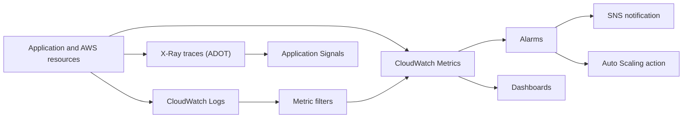

# 6. Monitoring

- [AWS Observability Overview](#aws-observability-overview)
- [CloudWatch Metrics](#cloudwatch-metrics)
- [CloudWatch Logs](#cloudwatch-logs)
- [CloudWatch Alarms and Dashboards](#cloudwatch-alarms-and-dashboards)
- [CloudWatch Application Monitoring](#cloudwatch-application-monitoring)
- [AWS X-Ray and OpenTelemetry](#aws-x-ray-and-opentelemetry)
- [AWS CloudTrail](#aws-cloudtrail)
- [AWS Config](#aws-config)
- [AWS Health Dashboard](#aws-health-dashboard)
- [Amazon DevOps Guru](#amazon-devops-guru)
- [AWS Compute Optimizer](#aws-compute-optimizer)
- [Database Monitoring](#database-monitoring)
- [Managed Prometheus and Grafana](#managed-prometheus-and-grafana)
- [Observability Costs](#observability-costs)

---

## AWS Observability Overview

| Signal | Service |
|---|---|
| Metrics | CloudWatch Metrics, Amazon Managed Service for Prometheus |
| Logs | CloudWatch Logs |
| Traces | AWS X-Ray, CloudWatch Application Signals |
| API activity (audit) | CloudTrail |
| Resource configuration | AWS Config |
| Service events | AWS Health |
| Visualization | CloudWatch Dashboards, Amazon Managed Grafana |

## CloudWatch Metrics

- AWS services send metrics to CloudWatch automatically.
- A metric has a namespace, a name and dimensions.
- EC2 basic monitoring sends data every 5 minutes. Detailed monitoring sends data every 1 minute.
- High-resolution custom metrics support 1-second periods.
- EC2 memory and disk metrics need the CloudWatch agent.
- Use the embedded metric format (EMF) to create metrics from structured logs.
- Metric Math and Metrics Insights (SQL) calculate new values from metrics.
- Metric streams send metrics to Firehose or partner tools in near real time.
- Cross-account observability lets one monitoring account see many source accounts.

## CloudWatch Logs

- Log groups contain log streams. Set a retention period on each log group.
- Sources: Lambda, ECS, EKS, API Gateway, VPC Flow Logs, CloudTrail and the CloudWatch agent.
- Logs Insights queries logs with a query language. It also supports SQL and OpenSearch PPL.
- Metric filters create metrics from log patterns.
- Subscription filters stream logs to Lambda, Kinesis, Firehose or OpenSearch.
- Live Tail shows log events in real time.
- Log classes: Standard and Infrequent Access (lower cost, fewer features).
- Export logs to S3 for long-term, low-cost storage.
- Data protection policies mask sensitive data in logs.
- Log anomaly detection finds unusual patterns.

## CloudWatch Alarms and Dashboards

- A metric alarm watches one metric or one math expression.
- States: OK, ALARM, INSUFFICIENT_DATA.
- Actions: SNS notification, Auto Scaling, EC2 actions and Systems Manager actions.
- Composite alarms combine alarms with AND, OR and NOT. They decrease alarm noise.
- Anomaly detection alarms use a model of normal metric behavior.
- Dashboards show metrics, logs and alarms from many Regions and accounts.

## CloudWatch Application Monitoring

| Feature | Purpose |
|---|---|
| Application Signals | Automatic service metrics, service maps and SLOs. It uses OpenTelemetry. |
| Synthetics | Canaries (scripts) test endpoints and UI flows on a schedule. |
| RUM | Real user monitoring for web page performance and errors. |
| Container Insights | Metrics and logs for ECS, EKS and Kubernetes. |
| Lambda Insights | System metrics for Lambda functions. |
| Internet Monitor | Internet health between users and your application. |
| Network Flow Monitor | Network performance between compute resources. |

- Application Signals defines SLOs on latency or availability. It tracks the error budget.

## AWS X-Ray and OpenTelemetry

- X-Ray collects distributed traces across services.
- A trace contains segments and subsegments. The service map shows dependencies.
- Sampling rules control the quantity of traces.
- AWS Distro for OpenTelemetry (ADOT) is the AWS distribution of OpenTelemetry.
- ADOT sends traces and metrics to X-Ray, CloudWatch, Managed Prometheus and partners.
- X-Ray supports OpenTelemetry (OTLP) ingestion. Use OpenTelemetry for new instrumentation.

## AWS CloudTrail

- CloudTrail records API calls in your account.
- Event types:
  - Management events: control plane actions, for example `CreateBucket`.
  - Data events: data plane actions, for example S3 `GetObject`. Extra cost.
  - Insights events: unusual API call rates or error rates.
- Event history keeps management events for 90 days without cost.
- A trail delivers events to S3 and optionally to CloudWatch Logs.
- Use an organization trail for all accounts in AWS Organizations.
- CloudTrail Lake stores events and supports SQL queries.
- Turn on log file integrity validation to detect changes.

## AWS Config

- Config records resource configurations and changes over time.
- Config rules check compliance. Use managed rules or custom rules (Lambda or Guard).
- Conformance packs group rules for a standard.
- Remediation uses Systems Manager Automation documents.
- Aggregators collect data from many accounts and Regions.

## AWS Health Dashboard

- The Service health view shows the public status of AWS services.
- The Your account health view shows events that affect your resources.
- Examples: scheduled maintenance, instance retirement and service issues.
- Send AWS Health events to EventBridge for automatic actions.
- Organizational view shows events for all accounts.

## Amazon DevOps Guru

- DevOps Guru uses ML to find operational problems.
- It analyzes CloudWatch metrics, CloudTrail events and Config data.
- It creates insights with recommendations.
- DevOps Guru for RDS finds database performance problems.

## AWS Compute Optimizer

- Compute Optimizer recommends better resource sizes.
- Resources: EC2, Auto Scaling groups, EBS, Lambda, ECS on Fargate, RDS and licenses.
- It uses CloudWatch utilization history.
- Install the CloudWatch agent to include memory metrics.

## Database Monitoring

- Performance Insights shows database load and top SQL statements for RDS and Aurora.
- CloudWatch Database Insights combines database metrics, logs and SQL analysis.
- AWS plans to move Performance Insights features to Database Insights. Check the current status.
- Enhanced Monitoring gives OS metrics for RDS instances.

## Managed Prometheus and Grafana

- Amazon Managed Service for Prometheus stores Prometheus metrics. It is compatible with PromQL.
- Use it for EKS and Kubernetes metrics.
- Amazon Managed Grafana gives managed Grafana workspaces.
- Grafana connects to CloudWatch, Prometheus, X-Ray, OpenSearch and other data sources.

## Observability Costs

- CloudWatch costs come from custom metrics, log ingestion, log storage, alarms, dashboards and queries.
- To decrease cost:
  - Set log retention periods.
  - Use the Infrequent Access log class for logs that you seldom query.
  - Export old logs to S3.
  - Decrease metric dimensions and high-resolution metrics.
  - Use sampling for traces.
  - Limit CloudTrail data events to the necessary resources.
- Use Cost Explorer to monitor CloudWatch spend.
