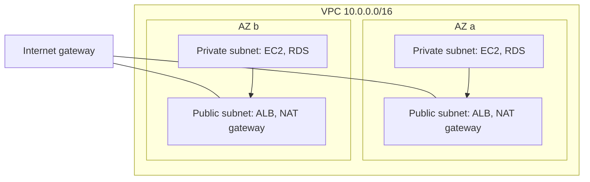
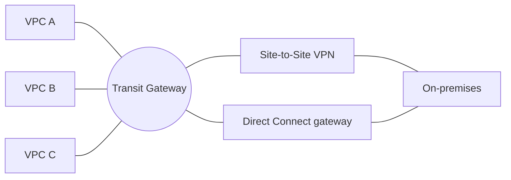

# 3. Networking

- [Amazon VPC](#amazon-vpc)
- [Subnets and routing](#subnets-and-routing)
- [Security groups and network ACLs](#security-groups-and-network-acls)
- [Internet and NAT](#internet-and-nat)
- [VPC endpoints and PrivateLink](#vpc-endpoints-and-privatelink)
- [Connecting VPCs](#connecting-vpcs)
- [Hybrid connectivity](#hybrid-connectivity)
- [Elastic Load Balancing](#elastic-load-balancing)
- [Amazon Route 53](#amazon-route-53)
- [Amazon CloudFront](#amazon-cloudfront)
- [AWS Global Accelerator](#aws-global-accelerator)
- [IP addresses](#ip-addresses)
- [Network monitoring](#network-monitoring)
- [Network performance](#network-performance)

---

## Amazon VPC

- A VPC is a private network in one Region. It spans all AZs in the Region.
- You give it an IPv4 CIDR block (/16 to /28). You can add IPv6.
- Each account has a **default VPC** in each Region.
- Use **VPC sharing** (AWS RAM) to share subnets with other accounts in the organization.

## Subnets and routing

- A subnet is in one AZ.
- A **public subnet** has a route to an internet gateway.
- A **private subnet** has no direct route to the internet.
- AWS reserves 5 IP addresses in each subnet.
- Each subnet has one **route table**. The most specific route wins.

## Security groups and network ACLs

| Feature | Security group | Network ACL |
|---|---|---|
| Level | ENI (instance) | Subnet |
| State | Stateful | Stateless |
| Rules | Allow only | Allow and deny |
| Order | All rules apply | Rules apply in number order |
| Default | Deny inbound, allow outbound | Default NACL allows all |

- A security group can refer to another security group as the source.

## Internet and NAT

- **Internet gateway**: two-way internet access for public subnets.
- **Egress-only internet gateway**: outbound IPv6 only.
- **NAT gateway**: outbound IPv4 access for private subnets. Put one in each AZ for high availability.
  - Cost: hourly fee plus fee per GB. Use VPC endpoints to reduce NAT data cost.
  - **Regional NAT gateway** mode can span AZs automatically.
- A **private NAT gateway** connects to other VPCs or on-premises with overlapping networks.

## VPC endpoints and PrivateLink

| Type | Services | Notes |
|---|---|---|
| Gateway endpoint | S3, DynamoDB | Route table entry. Free. |
| Interface endpoint (PrivateLink) | Most AWS services, SaaS, your services | ENI with private IP. Hourly and per-GB fee. |
| Gateway Load Balancer endpoint | Security appliances | Sends traffic to inspection appliances |

- **Endpoint policies** limit access through the endpoint.
- Use PrivateLink to expose your service to other VPCs behind a Network Load Balancer.
- **VPC Lattice** connects services across VPCs and accounts at the application layer, with auth policies.

## Connecting VPCs

| Option | Use |
|---|---|
| VPC peering | One-to-one link. Not transitive. No overlapping CIDRs. |
| Transit Gateway | Hub for many VPCs and on-premises networks. Transitive. Works across Regions with peering. |
| AWS Cloud WAN | Global network with central policy, built on Transit Gateway concepts |
| PrivateLink | Expose one service, not a full network. Overlapping CIDRs are OK. |

## Hybrid connectivity

- **AWS Site-to-Site VPN**: IPsec tunnels over the internet. Two tunnels per connection. Up to 1.25 Gbps per tunnel.
- **AWS Client VPN**: OpenVPN-based access for users.
- **AWS Direct Connect**: private dedicated link from 50 Mbps to 400 Gbps.
  - It is not encrypted by default. Use MACsec or VPN over Direct Connect.
  - For high availability, use two connections at two locations.
- **Direct Connect gateway**: connects one link to VPCs in many Regions.

## Elastic Load Balancing

| Type | Layer | Use |
|---|---|---|
| Application Load Balancer (ALB) | 7 (HTTP/HTTPS, gRPC) | Path and host routing, Lambda targets, WAF |
| Network Load Balancer (NLB) | 4 (TCP, UDP, TLS) | Very high performance, static IPs, PrivateLink |
| Gateway Load Balancer (GWLB) | 3 | Third-party firewalls and appliances |

- Load balancers do health checks and work across AZs.
- Use **target groups** for EC2, IP addresses, Lambda, or containers.

## Amazon Route 53

- Route 53 is a global DNS service and domain registrar. Its SLA is 100% availability.
- **Hosted zones**: public or private (VPC).
- Routing policies: simple, weighted, latency, failover, geolocation, geoproximity, IP-based, multivalue answer.
- **Health checks** support failover.
- **Alias records** point to AWS resources at the zone apex, without charge for queries.
- **Route 53 Resolver**: inbound and outbound endpoints for hybrid DNS. **DNS Firewall** filters queries.

## Amazon CloudFront

- CloudFront is a CDN with many edge locations.
- Origins: S3, ALB, EC2, API Gateway, or any HTTP server.
- Use **origin access control (OAC)** to keep S3 buckets private.
- Features: TLS, WAF, signed URLs and cookies, CloudFront Functions, Lambda@Edge.

## AWS Global Accelerator

- Global Accelerator gives two static anycast IPs. Traffic goes over the AWS network.
- It supports TCP and UDP. It fails over between Regions quickly.
- Use CloudFront for cacheable HTTP content. Use Global Accelerator for non-HTTP or static IP needs.

## IP addresses

- **Private IP**: stays with the ENI.
- **Public IP**: changes when the instance stops. AWS charges for all public IPv4 addresses.
- **Elastic IP**: static public IPv4 address.
- **BYOIP**: bring your own IP range.
- **Amazon VPC IPAM**: plans and tracks IP addresses across accounts.

## Network monitoring

- **VPC Flow Logs**: capture IP traffic metadata to CloudWatch Logs, S3, or Firehose.
- **Reachability Analyzer**: tests paths between two resources.
- **Network Access Analyzer**: finds unintended network access.
- **Traffic Mirroring**: copies packets for deep inspection.
- **CloudWatch Network Monitor and Internet Monitor**: measure latency and loss.

## Network performance

- Instance size controls network bandwidth.
- **Enhanced networking (ENA)** gives up to hundreds of Gbps on large instances.
- **Elastic Fabric Adapter (EFA)**: low-latency network for HPC and distributed ML training.
- **Cluster placement group**: puts instances close together for low latency.
- Traffic between AZs has a fee. Traffic inside one AZ with private IPs is free.
