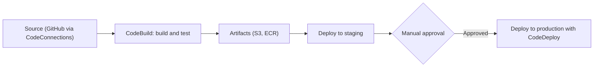
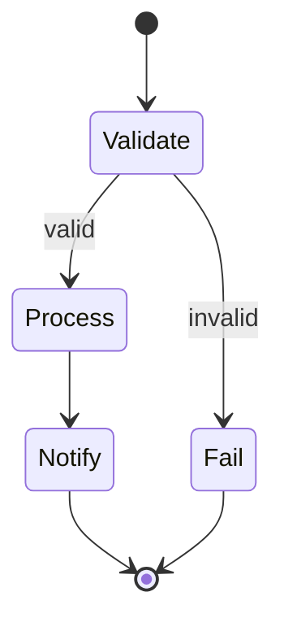

# 9. Orchestration, scheduling and CICD

- [CICD at AWS](#cicd-at-aws)
- [AWS CodePipeline](#aws-codepipeline)
- [AWS CodeBuild](#aws-codebuild)
- [AWS CodeDeploy](#aws-codedeploy)
- [Artifact Repositories: CodeArtifact and ECR](#artifact-repositories-codeartifact-and-ecr)
- [Source Control Integrations](#source-control-integrations)
- [Securing the CI/CD Pipeline](#securing-the-cicd-pipeline)
- [Third-Party Tooling](#third-party-tooling)
- [Orchestration and Scheduling](#orchestration-and-scheduling)
- [AWS Step Functions](#aws-step-functions)
- [Amazon MWAA](#amazon-mwaa)
- [EventBridge Scheduler and Pipes](#eventbridge-scheduler-and-pipes)
- [Amazon SQS for Task Queues](#amazon-sqs-for-task-queues)

---

## CICD at AWS

| Stage | AWS service |
|---|---|
| Source | GitHub, GitLab, Bitbucket (CodeConnections), S3, ECR |
| Build and test | CodeBuild |
| Artifacts | CodeArtifact (packages), ECR (images), S3 |
| Deploy | CodeDeploy, CloudFormation, ECS, Elastic Beanstalk |
| Orchestration | CodePipeline |

## AWS CodePipeline

- CodePipeline is a managed continuous delivery service.
- A pipeline has stages. A stage has actions.
- Action types: source, build, test, deploy, approval and invoke.
- V2 pipelines support triggers on Git tags, branches and file paths.
- V2 pipelines support pipeline variables and stage rollback.
- Use manual approval actions before production.
- Use cross-account roles to deploy to other accounts.

## AWS CodeBuild

- CodeBuild runs build and test commands in managed containers.
- The `buildspec.yml` file defines phases: install, pre_build, build, post_build.
- It creates artifacts and test reports.
- Compute options: Linux, Windows, Arm, GPU, Lambda compute and reserved capacity fleets.
- It can run as a self-hosted runner for GitHub Actions and GitLab.
- Use caching (S3 or local) to make builds faster.

## AWS CodeDeploy

- CodeDeploy deploys to EC2, on-premises servers, Lambda and ECS.
- The `appspec.yml` file defines files and life cycle hooks.

| Platform | Deployment options |
|---|---|
| EC2 / on-premises | In-place (rolling), blue/green |
| Lambda | Canary, linear, all-at-once (alias traffic shift) |
| ECS | Blue/green with canary, linear or all-at-once |

- Use CloudWatch alarms for automatic rollback.

## Artifact Repositories: CodeArtifact and ECR

- CodeArtifact stores software packages: npm, PyPI, Maven, NuGet, Cargo and others.
- CodeArtifact can proxy public repositories through upstream repositories.
- Amazon ECR stores OCI and Docker images.
- ECR features:
  - Image scanning (basic and enhanced with Amazon Inspector).
  - Tag immutability.
  - Life cycle policies to delete old images.
  - Cross-Region and cross-account replication.
  - Pull through cache for public registries.

## Source Control Integrations

- AWS CodeConnections (previously CodeStar Connections) connects to GitHub, GitLab and Bitbucket.
- AWS stopped CodeCommit for new customers in July 2024. In November 2025, AWS returned CodeCommit to general availability.
- For new projects, many teams use GitHub or GitLab with CodeConnections.

## Securing the CI/CD Pipeline

- Give each pipeline stage an IAM role with least privilege.
- Use OIDC federation for GitHub Actions. Do not keep long-term access keys.
- Keep secrets in Secrets Manager or Parameter Store.
- Scan code and dependencies with Amazon Inspector code scanning or third-party tools.
- Scan images in ECR with Amazon Inspector.
- Sign container images with AWS Signer and Notation.
- Encrypt artifacts in S3 with AWS KMS.
- Record pipeline actions with CloudTrail.

## Third-Party Tooling

- GitHub Actions and GitLab CI can deploy to AWS with OIDC roles.
- Jenkins can run on EC2 or EKS. It can use CodeBuild as a build agent.
- Argo CD and Flux give GitOps deployments to EKS.
- Terraform and Pulumi manage infrastructure as code.

## Orchestration and Scheduling

| Service | Use it for |
|---|---|
| Step Functions | Serverless workflows with states, retries and AWS service integrations |
| MWAA | Apache Airflow DAGs for data pipelines |
| EventBridge Scheduler | Cron and one-time schedules for many targets |
| EventBridge Pipes | Point-to-point integration from source to target |
| SQS | Queue tasks for workers |
| AWS Batch | Batch jobs at scale |
| Glue Workflows | Glue job and crawler chains |

## AWS Step Functions

- Step Functions orchestrates steps as a state machine.
- You define workflows in Amazon States Language (JSON) or with Workflow Studio.
- Workflow types:
  - Standard: up to 1 year, exactly-once execution, full history.
  - Express: up to 5 minutes, high volume, at-least-once.
- States: Task, Choice, Parallel, Map, Wait, Pass, Succeed and Fail.
- Distributed Map processes millions of items, for example S3 objects.
- Use Retry and Catch to handle errors.
- SDK integrations call more than 200 AWS services directly.
- JSONata support makes data transformation simpler.

## Amazon MWAA

- Amazon Managed Workflows for Apache Airflow runs Airflow in a managed environment.
- DAGs, plugins and requirements live in an S3 bucket.
- Use it when teams already use Airflow or need many Airflow operators.
- MWAA Serverless runs workflows without an environment to manage. Check Region availability.

## EventBridge Scheduler and Pipes

- EventBridge Scheduler runs cron, rate and one-time schedules.
- It supports time zones, flexible time windows, retries and dead-letter queues.
- It calls more than 270 AWS services as targets.
- EventBridge Pipes connects a source to a target.
- Pipe sources: SQS, Kinesis, DynamoDB Streams, MSK, Amazon MQ.
- Pipes support filters, enrichment (Lambda, Step Functions, API Gateway) and transformation.

## Amazon SQS for Task Queues

- Use SQS to send tasks to a group of workers.
- Workers scale with the queue depth metric (`ApproximateNumberOfMessagesVisible`).
- Use a dead-letter queue for messages that fail many times.
- Use message delay for deferred tasks (up to 15 minutes).
- Use FIFO queues when order is necessary.
