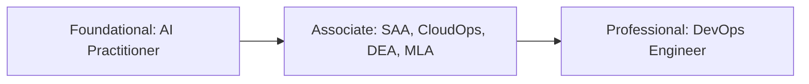

# 0. Rubric of the exams

- [AWS Certified Machine Learning Engineer – Associate (MLA-C01)](#aws-certified-machine-learning-engineer--associate-mla-c01)
- [AWS Certified AI Practitioner (AIF-C01)](#aws-certified-ai-practitioner-aif-c01)
- [AWS Certified Data Engineer – Associate (DEA-C01)](#aws-certified-data-engineer--associate-dea-c01)
- [AWS Certified DevOps Engineer – Professional (DOP-C02)](#aws-certified-devops-engineer--professional-dop-c02)
- [AWS Certified Solutions Architect – Associate (SAA-C03)](#aws-certified-solutions-architect--associate-saa-c03)
- [AWS Certified CloudOps Engineer – Associate (SOA-C03)](#aws-certified-cloudops-engineer--associate-soa-c03)

---

> **Note:** AWS changes exam guides. Before you study, check the official exam guide at <https://aws.amazon.com/certification/>. The weights below are approximate.

## AWS Certified Machine Learning Engineer – Associate (MLA-C01)

| Domain | Weight | Key services |
|---|---|---|
| 1. Data preparation for ML | 28% | S3, Glue, Glue DataBrew, SageMaker Data Wrangler, SageMaker Feature Store, Athena, EMR, Kinesis, Lake Formation |
| 2. ML model development | 26% | SageMaker Training, built-in algorithms, JumpStart, Bedrock, Automatic Model Tuning, Clarify, Debugger, Experiments |
| 3. Deployment and orchestration of ML workflows | 22% | SageMaker endpoints (real-time, serverless, asynchronous, batch transform), SageMaker Pipelines, Model Registry, CodePipeline, Step Functions, ECR, CloudFormation, CDK |
| 4. ML solution monitoring, maintenance, and security | 24% | SageMaker Model Monitor, CloudWatch, CloudTrail, IAM, KMS, VPC, Cost Explorer |

## AWS Certified AI Practitioner (AIF-C01)

| Domain | Weight | Key services |
|---|---|---|
| 1. Fundamentals of AI and ML | 20% | SageMaker, Rekognition, Comprehend, Transcribe, Translate, Polly, Lex |
| 2. Fundamentals of generative AI | 24% | Bedrock, Amazon Q, SageMaker JumpStart |
| 3. Applications of foundation models | 28% | Bedrock Knowledge Bases, Bedrock Agents, prompt engineering, fine-tuning, model evaluation |
| 4. Guidelines for responsible AI | 14% | Bedrock Guardrails, SageMaker Clarify, Amazon A2I, SageMaker Model Cards |
| 5. Security, compliance, and governance for AI | 14% | IAM, KMS, Macie, CloudTrail, AWS Config, Artifact, Audit Manager |

## AWS Certified Data Engineer – Associate (DEA-C01)

| Domain | Weight | Key services |
|---|---|---|
| 1. Data ingestion and transformation | 34% | Kinesis, MSK, DMS, AppFlow, Glue, EMR, Lambda, Step Functions, MWAA |
| 2. Data store management | 26% | S3, Redshift, DynamoDB, RDS, Aurora, Glue Data Catalog, Lake Formation |
| 3. Data operations and support | 22% | Athena, QuickSight, CloudWatch, Glue Data Quality, EventBridge |
| 4. Data security and governance | 18% | IAM, KMS, Lake Formation, Macie, CloudTrail, Secrets Manager |

## AWS Certified DevOps Engineer – Professional (DOP-C02)

| Domain | Weight | Key services |
|---|---|---|
| 1. SDLC automation | 22% | CodePipeline, CodeBuild, CodeDeploy, CodeArtifact, ECR |
| 2. Configuration management and IaC | 17% | CloudFormation, CDK, Systems Manager, Organizations, Control Tower |
| 3. Resilient cloud solutions | 15% | Auto Scaling, ELB, Route 53, Aurora Global Database, DynamoDB global tables, AWS Backup |
| 4. Monitoring and logging | 15% | CloudWatch, CloudWatch Logs, X-Ray, CloudTrail |
| 5. Incident and event response | 14% | EventBridge, Systems Manager OpsCenter, Incident Manager, SNS, Lambda |
| 6. Security and compliance | 17% | IAM, IAM Identity Center, AWS Config, Security Hub, GuardDuty, Inspector |

## AWS Certified Solutions Architect – Associate (SAA-C03)

| Domain | Weight | Key services |
|---|---|---|
| 1. Design secure architectures | 30% | IAM, Organizations, KMS, WAF, Shield, Cognito, VPC security |
| 2. Design resilient architectures | 26% | Multi-AZ, ELB, Auto Scaling, SQS, SNS, Route 53 |
| 3. Design high-performing architectures | 24% | EC2, Lambda, ElastiCache, CloudFront, EBS, EFS, DynamoDB |
| 4. Design cost-optimized architectures | 20% | Savings Plans, Spot Instances, S3 storage classes, Cost Explorer, Budgets |

## AWS Certified CloudOps Engineer – Associate (SOA-C03)

This exam replaces the SysOps Administrator – Associate (SOA-C02) exam.

| Domain | Weight | Key services |
|---|---|---|
| 1. Monitoring, logging, analysis, remediation, and performance optimization | 22% | CloudWatch, CloudTrail, Systems Manager, Compute Optimizer |
| 2. Reliability and business continuity | 22% | Auto Scaling, ELB, AWS Backup, Route 53, Multi-AZ |
| 3. Deployment, provisioning, and automation | 22% | CloudFormation, CDK, Systems Manager, ECS, EKS |
| 4. Security and compliance | 16% | IAM, KMS, AWS Config, Security Hub |
| 5. Networking and content delivery | 18% | VPC, Route 53, CloudFront, Transit Gateway, VPC endpoints |
