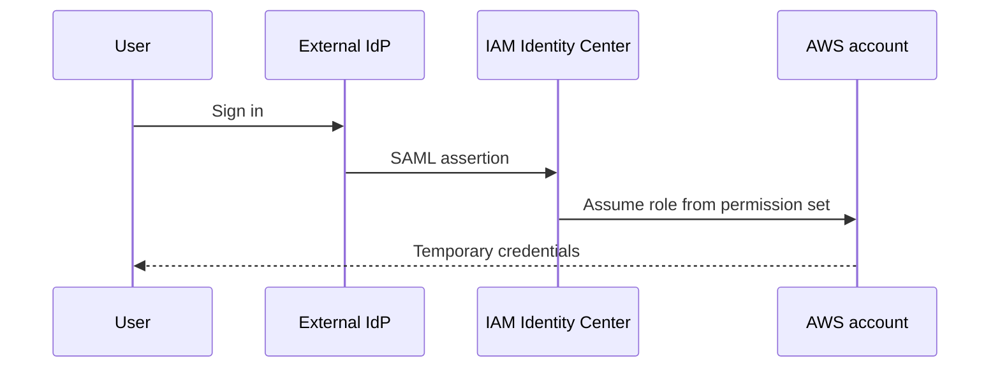
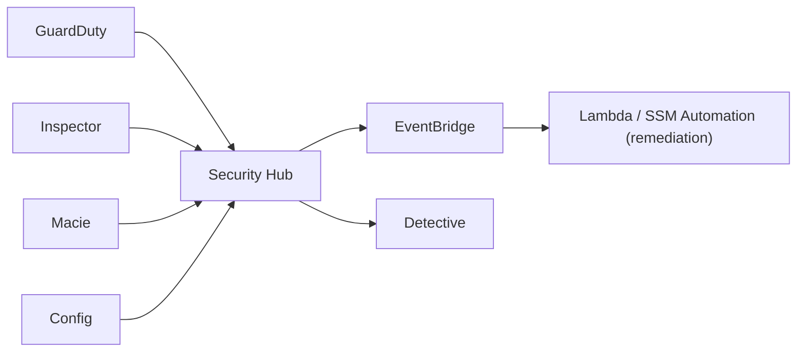

# 2. Security and privacy

- [Shared responsibility model](#shared-responsibility-model)
- [IAM roles for workloads](#iam-roles-for-workloads)
- [Short-lived credentials](#short-lived-credentials)
- [Federation](#federation)
- [Amazon Cognito](#amazon-cognito)
- [Best practices for identities](#best-practices-for-identities)
- [Encryption](#encryption)
- [AWS KMS](#aws-kms)
- [AWS CloudHSM](#aws-cloudhsm)
- [AWS Secrets Manager](#aws-secrets-manager)
- [Systems Manager Parameter Store](#systems-manager-parameter-store)
- [AWS Certificate Manager](#aws-certificate-manager)
- [Threat detection and posture](#threat-detection-and-posture)
- [Network protection](#network-protection)
- [Privacy and compliance](#privacy-and-compliance)

---

## Shared responsibility model

- AWS secures the cloud: hardware, facilities, and the global network.
- You secure what is in the cloud: data, identities, configuration, and the guest OS.
- Your part decreases with managed services. For example, AWS patches the Lambda runtime.

## IAM roles for workloads

- Do not put access keys in code. Give a role to the workload.

| Workload | Mechanism |
|---|---|
| EC2 | Instance profile |
| Lambda | Execution role |
| ECS task | Task role |
| EKS pod | EKS Pod Identity or IAM roles for service accounts (IRSA) |
| SageMaker | Execution role |

- A **trust policy** controls who can assume the role.
- A **permissions policy** controls what the role can do.

## Short-lived credentials

- AWS STS issues temporary credentials. They expire after 15 minutes to 12 hours.
- Use **IAM Roles Anywhere** for servers outside AWS. It uses X.509 certificates.
- Use **OIDC federation** for CI/CD (GitHub Actions, GitLab). No long-term keys are necessary.

## Federation

- Workforce users: IAM Identity Center with SAML 2.0 and SCIM.
- Direct SAML or OIDC federation to IAM is also possible for one account.

## Amazon Cognito

- Cognito gives authentication for customer-facing applications.
- **User pools**: user directory, sign-up, sign-in, MFA, social and SAML IdPs. They issue JWT tokens.
- **Identity pools**: exchange tokens for temporary AWS credentials.
- Use Cognito for app users. Use Identity Center for employees.

## Best practices for identities

- Turn on MFA for the root user and all people.
- Give least privilege. Start with AWS managed policies, then reduce.
- Use roles and temporary credentials.
- Rotate or remove unused credentials. Use IAM Access Analyzer unused access findings.
- Use SCPs to block risky actions, for example leaving the organization.
- Log all API calls with CloudTrail.

## Encryption

- **At rest**: most services encrypt with KMS keys. S3 encrypts all new objects by default (SSE-S3).
- **In transit**: use TLS. Use ACM certificates on load balancers and CloudFront.
- S3 encryption options:

| Option | Key owner |
|---|---|
| SSE-S3 | AWS manages the key |
| SSE-KMS | KMS key that you control and audit |
| DSSE-KMS | Two layers of KMS encryption |
| SSE-C | You give the key with each request |
| Client-side | You encrypt before upload |

## AWS KMS

- KMS creates and manages encryption keys. Keys stay in FIPS 140-3 validated HSMs.
- Key types:
  - **AWS owned keys**: free, not visible to you.
  - **AWS managed keys**: `aws/service`, rotate each year, you cannot change the policy.
  - **Customer managed keys**: you control the policy, rotation, and deletion.
- **Envelope encryption**: KMS encrypts a data key. The data key encrypts the data.
- **Key policy** is the main access control. Grants give temporary access.
- **Multi-Region keys** have the same key material in many Regions.
- **External key store (XKS)** keeps keys outside AWS.
- Cost: a monthly fee per customer managed key and a fee per API request.

## AWS CloudHSM

- CloudHSM gives dedicated, single-tenant HSMs in your VPC.
- You fully control the keys. AWS cannot access them.
- Use it for strict compliance or for custom key stores in KMS.

## AWS Secrets Manager

- Secrets Manager stores secrets, such as database passwords and API keys.
- It rotates secrets automatically with Lambda. RDS, Aurora, and Redshift have managed rotation.
- It replicates secrets to other Regions.
- Cost: a monthly fee per secret and per API call.

## Systems Manager Parameter Store

- Parameter Store stores configuration values and secrets (`SecureString` with KMS).
- Standard parameters are free. It has no automatic rotation.
- Use Parameter Store for configuration. Use Secrets Manager for secrets that need rotation.

## AWS Certificate Manager

- ACM issues free public TLS certificates and renews them automatically.
- ACM certificates attach to ELB, CloudFront, API Gateway, and App Runner.
- For CloudFront, request the certificate in `us-east-1`.
- **AWS Private CA** issues private certificates for internal use.

## Threat detection and posture

| Service | Function |
|---|---|
| Amazon GuardDuty | Finds threats from CloudTrail, VPC Flow Logs, DNS logs, EKS, S3, and runtime data |
| Amazon Inspector | Scans EC2, ECR images, and Lambda for vulnerabilities |
| Amazon Macie | Finds sensitive data (PII) in S3 |
| AWS Security Hub | Collects findings and checks security standards |
| Amazon Detective | Investigates the root cause of findings |
| AWS Config | Records configuration and checks rules |
| AWS CloudTrail | Logs API activity |
| AWS Security Incident Response | Helps to prepare for and respond to incidents |

## Network protection

- **AWS WAF**: filters HTTP requests on CloudFront, ALB, API Gateway, AppSync, and Cognito.
- **AWS Shield Standard**: free DDoS protection for all customers.
- **AWS Shield Advanced**: more DDoS protection, response team support, and cost protection.
- **AWS Network Firewall**: stateful firewall for VPC traffic.
- **AWS Firewall Manager**: manages WAF, Shield, security groups, and Network Firewall across accounts.

## Privacy and compliance

- **AWS Artifact**: download AWS compliance reports (SOC, ISO, PCI).
- **AWS Audit Manager**: collects evidence for audits.
- Data stays in the Region that you choose. AWS does not move it.
- Use Macie to find PII. Use KMS and access controls to protect it.
- Use the **AI services opt-out policy** to stop AWS AI services from storing your content for improvement.
