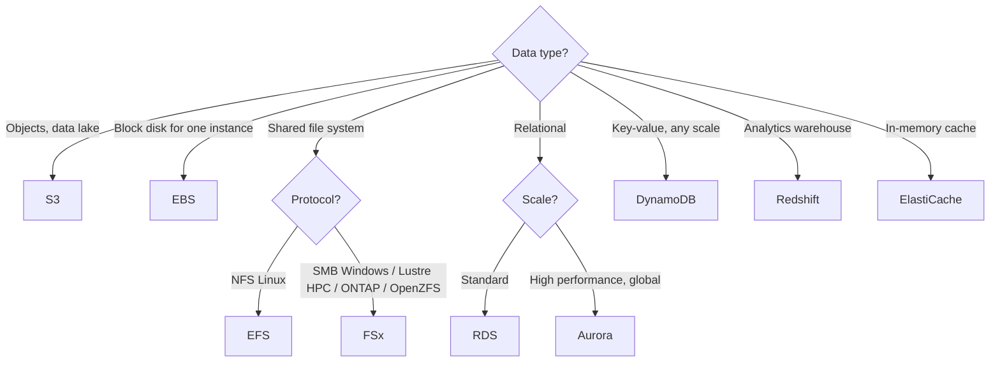

# 4. Storage

- [Selecting the storage system](#selecting-the-storage-system)
- [Amazon S3](#amazon-s3)
- [Amazon EBS](#amazon-ebs)
- [Amazon EFS](#amazon-efs)
- [Amazon FSx](#amazon-fsx)
- [Amazon RDS](#amazon-rds)
- [Amazon Aurora](#amazon-aurora)
- [Amazon DynamoDB](#amazon-dynamodb)
- [Other NoSQL databases](#other-nosql-databases)
- [Amazon Redshift](#amazon-redshift)
- [Amazon ElastiCache and MemoryDB](#amazon-elasticache-and-memorydb)
- [AWS Backup](#aws-backup)
- [Multi-Region redundancy](#multi-region-redundancy)
- [Storage cost estimation](#storage-cost-estimation)

---

## Selecting the storage system

## Amazon S3

- S3 is object storage. It has 11 nines (99.999999999%) of durability.
- Objects are in **buckets**. Maximum object size is 50 TB.
- S3 has strong read-after-write consistency.
- Storage classes:

| Class | Use | Minimum duration |
|---|---|---|
| S3 Standard | Frequent access | None |
| S3 Intelligent-Tiering | Unknown or changing access | None |
| S3 Express One Zone | Single-digit ms latency, one AZ | None |
| S3 Standard-IA | Infrequent access | 30 days |
| S3 One Zone-IA | Infrequent, re-creatable data | 30 days |
| S3 Glacier Instant Retrieval | Archive, ms access | 90 days |
| S3 Glacier Flexible Retrieval | Archive, minutes to hours | 90 days |
| S3 Glacier Deep Archive | Long archive, up to 48 hours | 180 days |

- Features:
  - **Lifecycle rules**: move or delete objects automatically.
  - **Versioning** and **Object Lock** (WORM) protect data.
  - **Replication**: Cross-Region (CRR) and Same-Region (SRR).
  - **Block Public Access**: on by default for new buckets.
  - **S3 Tables**: managed Apache Iceberg tables.
  - **S3 Vectors**: low-cost storage and query for vector embeddings.
  - **Multipart upload** and **Transfer Acceleration** for large uploads.
  - **Event notifications** to Lambda, SQS, SNS, or EventBridge.
- Mount S3 as a file system with **Mountpoint for Amazon S3**.

## Amazon EBS

- EBS gives block volumes for EC2. A volume is in one AZ.
- Volume types:

| Type | Use |
|---|---|
| gp3 | General purpose SSD. Set IOPS and throughput separately. |
| io2 Block Express | High IOPS, 99.999% durability, multi-attach |
| st1 | Throughput HDD for big data |
| sc1 | Cold HDD, lowest cost |

- **Snapshots** go to S3 storage. They are incremental. Copy them to other Regions.
- Use **Data Lifecycle Manager** to automate snapshots.
- **Instance store** is temporary disk on the host. Data is lost when the instance stops.

## Amazon EFS

- EFS is a managed NFS file system for Linux. It grows and shrinks automatically.
- Many instances in many AZs can mount it at the same time.
- Classes: Standard, Infrequent Access, and Archive. Lifecycle policies move files.
- Throughput modes: Elastic (recommended), Provisioned, and Bursting.

## Amazon FSx

| Option | Use |
|---|---|
| FSx for Windows File Server | SMB, Active Directory, Windows workloads |
| FSx for Lustre | HPC and ML training. Links to S3. |
| FSx for NetApp ONTAP | NFS, SMB, iSCSI. Lift and shift NetApp. |
| FSx for OpenZFS | NFS with ZFS features |

## Amazon RDS

- RDS is a managed relational database.
- Engines: MySQL, PostgreSQL, MariaDB, Oracle, SQL Server, and Db2.
- **Multi-AZ**: a standby in another AZ with automatic failover.
- **Multi-AZ DB cluster**: two readable standbys.
- **Read replicas**: scale reads. They can be in other Regions.
- Automated backups keep data for up to 35 days with point-in-time restore.
- **RDS Proxy** pools connections, good for Lambda.
- **RDS Custom** gives OS access for Oracle and SQL Server.

## Amazon Aurora

- Aurora is a MySQL- and PostgreSQL-compatible database from AWS.
- Storage keeps six copies in three AZs. It grows automatically to 256 TiB (128 TiB on older versions).
- Up to 15 low-lag read replicas.
- **Aurora Serverless v2**: scales capacity automatically, and can scale to zero.
- **Aurora Global Database**: one primary Region and up to 10 secondary Regions. Replication lag is typically under 1 second.
- **Aurora DSQL**: serverless, distributed SQL with active-active multi-Region writes.
- Aurora PostgreSQL supports **pgvector** for vector search.

## Amazon DynamoDB

- DynamoDB is a serverless key-value and document database. It gives single-digit ms latency at any scale.
- Data model: table, partition key, and optional sort key.
- Indexes: **Global secondary index (GSI)** and **local secondary index (LSI)**.
- Capacity modes: **on-demand** and **provisioned** with auto scaling.
- Features:
  - **DynamoDB Streams**: change data capture to Lambda.
  - **Global tables**: active-active multi-Region replication.
  - **DAX**: in-memory cache with microsecond reads.
  - **TTL**: delete expired items without cost.
  - **PITR** and on-demand backups.
  - **Zero-ETL** to Redshift and OpenSearch.

## Other NoSQL databases

| Service | Type |
|---|---|
| Amazon DocumentDB | MongoDB-compatible document database |
| Amazon Keyspaces | Apache Cassandra-compatible wide column |
| Amazon Neptune | Graph database (Gremlin, openCypher, SPARQL) |
| Amazon Timestream | Time series (LiveAnalytics and InfluxDB) |
| Amazon OpenSearch Service | Search, log analytics, vector search |

## Amazon Redshift

- Redshift is a petabyte-scale data warehouse with columnar storage.
- Options: provisioned RA3 clusters or **Redshift Serverless**.
- **Redshift Spectrum** queries data in S3.
- **Data sharing** shares live data between warehouses without copies.
- **Redshift ML** trains models with SQL through SageMaker.
- Refer to section 11 for more.

## Amazon ElastiCache and MemoryDB

- **ElastiCache**: managed Valkey, Redis OSS, and Memcached. Use it as a cache.
- **ElastiCache Serverless**: no capacity planning.
- **MemoryDB**: durable in-memory database, Valkey and Redis OSS compatible. Use it as a primary database.
- Memcached has no replication or persistence. Valkey and Redis OSS have both.

## AWS Backup

- AWS Backup manages backups for EBS, EC2, RDS, Aurora, DynamoDB, EFS, FSx, S3, and more.
- **Backup plans** set schedule and retention.
- **Backup Vault Lock** makes backups immutable.
- Copy backups to other Regions and accounts.

## Multi-Region redundancy

| Service | Mechanism |
|---|---|
| S3 | Cross-Region Replication, Multi-Region Access Points |
| DynamoDB | Global tables |
| Aurora | Global Database, DSQL |
| RDS | Cross-Region read replicas |
| EBS | Snapshot copy |
| All | AWS Backup cross-Region copy, AWS Elastic Disaster Recovery |

## Storage cost estimation

- S3 cost has four parts: storage per GB-month, requests, data retrieval, and data transfer out.
- Use **S3 Storage Lens** to analyze usage across accounts.
- Use Intelligent-Tiering when the access pattern is unknown.
- EBS: you pay for provisioned size, not used size. Delete unattached volumes.
- Use the **AWS Pricing Calculator** to estimate costs.
